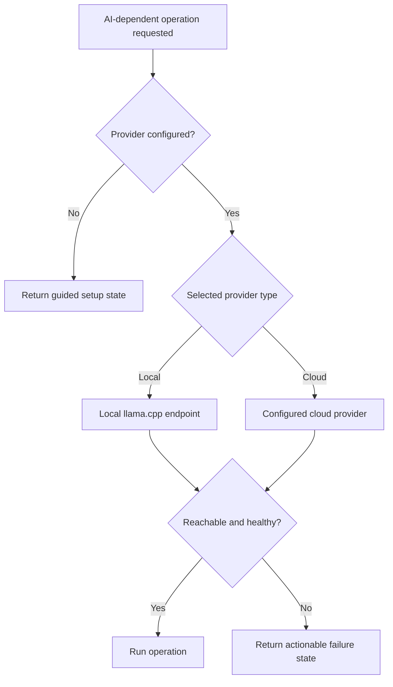

# AI Architecture

## Deferred Setup Mode

Hatch supports `not_configured` / AI-deferred mode. In this state the workspace remains usable for profile editing, settings, tracking, and manual workflow management.

## Local AI Mode

Local AI uses `llama.cpp` services started through `docker-compose.local-ai.yml`. The primary and triage services are configured separately and mount models from `${HATCH_HOME}/models` in easy installs or `./data/models` in the developer stack.

## Cloud Provider Mode

Cloud mode depends on host-managed secrets and a configured provider. The browser and backend do not collect provider API keys in the current setup flow.

## Model Tiers

Local inference runs in two `llama.cpp` services. `backend/app/config/model_tiers.json` maps each tier to a route, model and budget:

| Tier | Service and port | Model (main, November 2026) | Budget | Used for |
|---|---|---|---|---|
| T (triage) | `llm-triage`, `:8081` | MiniCPM5-2B Q4_K_M | 1,200 input / 512 output tokens, 30 s | job relevance triage (`scorer_agent`), job classification (`services/job_classifier.py`), Coach Phase 2 `debrief_extract` and `competency_extract` |
| S (primary) | `llm-primary`, `:8080` | Qwen3.5-4B Q4_K_M | 4,096 input / 600 output tokens, 90 s | job fit sub-scores and reasoning, CV and cover-letter tailoring, JD analysis, ATS scoring, coach evaluation and evidence grounding, follow-up proposals, Coach Phase 2 `explain` and `brief_enhance` |

Both services run with reasoning off. Agents reach them through `backend/app/agents/tools/llm_factory.py` (`get_triage_model`, `get_primary_model`); `services/llm_client.py` always uses the primary model. Runtime-migrated slices (job score, CV tailor, cover letter) select models through the Intelligence Plane router in `backend/app/runtime/intelligence/router.py` (ARCH-03).

Promotion of a model into a tier is an owner decision backed by benchmark evidence in `docs/benchmarks/`.

## Decisions Versus Generation

Hatch currently asks the generative tiers to produce many numbers and labels (fit sub-scores, job labels, coach dimension levels, claim status). Benchmarks in November 2026 showed these outputs are uncalibrated and vary between runs. The agreed target splits AI work into three layers: rules for facts, a local decision model for every yes/no, fixed-choice or ordinal judgement, and the generative tiers for prose only. The full inventory of decision points and the proposed design are in [Decision layer (proposed)](DECISION_LAYER.md). Until it is implemented, the tiers above remain the source of every AI decision.

## Hardware Probe And Recommendations

`hatch probe` records a host-side hardware snapshot under `${HATCH_HOME}/probe` and `${HATCH_HOME}/config/hardware_probe_latest.json`. Setup endpoints use that snapshot to recommend local AI or cloud/deferred fallbacks.

## Model Catalogue And Installation

The model catalogue lives at `backend/app/config/model_catalog.json`. `hatch models list` and `hatch models install` are the current host flows for viewing and downloading supported models.

## Provider Selection

Current UI-supported provider choices are:

- Google Gemini
- OpenRouter
- OpenAI
- Anthropic

## Reachability And Health Checks

The setup flow exposes provider tests and local hardware/runtime status. Local model services also expose health endpoints on `:8080` and `:8081`.

## Secret Management

Easy installs keep provider secrets in `${HATCH_HOME}/config/secrets.env`. That file is written by the host CLI, not by the browser.

## Fallback And Degraded Behavior

- No provider configured: guided setup state
- Local models missing: setup remains incomplete
- Cloud secret missing: actionable host command is returned
- Optional capability absent: affected feature remains unavailable rather than silently half-working

## Capability-Gated AI Features

The backend profile controls optional browser automation, local embeddings, perception, and advanced coach capabilities independently from the chosen AI runtime. The proposed decision service would be enabled the same way, as an opt-in profile (see [Decision layer](DECISION_LAYER.md)).

## External Data Disclosure

Cloud providers receive data only when configured and used for an operation. Local AI keeps prompts inside the local workspace.

## AI Routing

## Related Guides

- [Decision layer (proposed)](DECISION_LAYER.md)

- [Local models](../operations/LOCAL_MODELS.md)
- [Cloud providers](../operations/CLOUD_PROVIDERS.md)
- [Troubleshooting](../getting-started/TROUBLESHOOTING.md)
