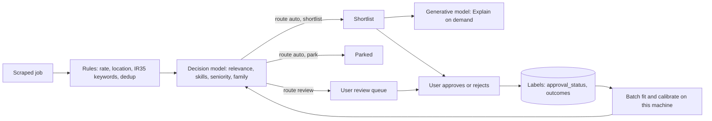

# Decision Layer (proposed)

> **Status: proposed, not implemented.** This document is the agreed target design for how Hatch makes decisions. It records the analysis, the placement of a local decision model (Laya) across the whole system, the training loop and the rollout. Nothing here changes behaviour until a spec implements it behind a flag. Runtime decision record: ARCH-13 in [Runtime architecture](Hatch_Runtime_Architecture_Pre_Coach_Phase2_v8_FINAL.md).

## 1. Problem

Hatch asks generative models to produce numbers and labels. Model benchmarks from November 2026 (Spark-X2.6-4B at Q4 and Q8, and Qwen3.5-4B, on synthetic job sets) showed the same failure for all of them:

- Sub-scores such as `skill_match` are not calibrated. Poor-fit technical roles scored 0.55–0.85, so three of five poor fits were shortlisted at the 0.75 cutoff.
- Results change between runs. With no rate in the advert, `rate_match` swung between 0 and 1.
- Turning reasoning on fixed the separation (0 of 5 poor fits shortlisted) but cost 15–20 minutes per job on this hardware.

The weakness is structural, not a model-size problem. A text generator is the wrong tool for a calibrated yes/no or a choice from fixed labels.

## 2. Target design: three layers

| Layer | Owns | Examples | Properties |
|---|---|---|---|
| **Rules** (code) | Facts that can be read from the data | rate parsing and band, location and remote fit, IR35 keywords, dates, duplicate titles, thresholds | Deterministic, explainable, always available (AI mode None) |
| **Decision model** (Laya, local) | Every binary, fixed-choice or ordinal judgement | relevance, skills fit, seniority fit, job family, claim supported, coverage level, follow-up reason | One forward pass, same answer every run, calibrated probability, conformal prediction set, `abstain`, `route` = `auto` or `review`, trainable from labels on this machine |
| **Generative model** (Qwen3.5-4B primary, MiniCPM triage) | Prose and open extraction only | CV and cover letter, emails, briefs, tips, "Explain", claim extraction, competency extraction | Proposes text; never produces a score that gates an action |

Binding rules for the layer split:

1. A generative model never writes a number or label that gates a workflow step once that decision has a decision-model or rules owner.
2. Each decision has exactly one owner. Today employment type, IR35 and working pattern are each classified three times (scraper rules, job classifier, JD analyser) and `job_postings.match_score` is written by both the classifier and the scorer. The decision layer removes that duplication.
3. Decision-model output is a proposal. Principle 4.2 of the runtime architecture still applies: deterministic code authorizes, and the human approves any external action.
4. `route = review` is a first-class outcome. An uncertain decision goes to the user's review queue instead of being forced into shortlist or park.
5. With AI mode set to None, or the decision service absent, rules give a deterministic result and the feature still renders.

## 3. Decision-point inventory

Every decision Hatch makes today, its current mechanism, and the proposed owner. Paths are under `backend/app/`. Input length: S short (titles, first 500 characters), M medium (a JD or a transcript), L long (CV plus JD).

### 3.1 Job pipeline (runs per job; highest volume)

| Decision | Where today | Mechanism today | Output | Proposed owner | Labels available |
|---|---|---|---|---|---|
| Relevant to target roles | `agents/tools/scoring_contract.py` `_build_triage_prompt`, called from `agents/scorer_agent.py` and `runtime_bindings/migration/scoring.py` | T-tier LLM | binary | **Decision model** (yes/no) | `applications.approval_status`; job dismissal |
| Skill, experience, rate, location match | `scoring_contract.py` `_build_llm_judge_prompt` / `_build_scoring_prompt` | S-tier LLM, about 2 minutes a job | four 0–1 numbers, recomputed as a weighted sum | **Decision model** for core skills met (yes/no), seniority (under / at / over), job family (choice), domain fit (yes/no). **Rules** for rate and location. | approve/reject, `applications.status`, `application_outcomes`, `application_score_snapshots` |
| Send to LLM or not (hybrid band) | `scorer_agent.py` `_run_hybrid`, `scoring.py` `prepare_job_score_batch` | heuristic band around threshold | binary | Retired: the decision model is cheap enough to score every job | — |
| Local keyword score | `agents/tools/local_scorer.py` | regex and keyword bands | numbers | **Rules**, kept as fallback and as decision-model input features | — |
| Semantic fit | `agents/tools/semantic_scorer.py` | embedding cosine | number | Kept as an optional feature | — |
| Shortlist or park | `agents/supervisor.py` `_handle_job_scored` | fixed threshold | binary | **Decision model `route`** (auto shortlist / auto park / review) | approve/reject |
| Employment type, IR35, working pattern, seniority, match score | `services/job_classifier.py` (T-tier), `scrapers/base.py` `detect_*` (keywords), `services/jd_analyser.py` (S-tier) | three sources | fixed choices | **Rules first** where the text is explicit; **decision model** (choice) when not; one stored value | `PATCH /jobs/{id}` IR35 edits; synthetic labels |
| Duplicate posting | `services/dedup.py` | rapidfuzz ratio | binary | **Rules** (unchanged); decision model only for the borderline fuzzy band, later | — |
| Ghost or suspicious posting | `services/ghost_detector.py` | weighted rules | four verdicts | **Rules** (unchanged); decision-model probability may become one input later | `agency_reputation` from outcomes |
| Untrusted advert text (injection or abuse) | none | none | binary | **Decision model** gate before any LLM reads scraped text (see security spec task H4) | synthetic |

### 3.2 Tailoring

| Decision | Where today | Mechanism today | Proposed owner | Labels |
|---|---|---|---|---|
| Tailored bullet supported by the master CV | `services/grounding_validator.py` | rapidfuzz similarity below 70 flags | **Decision model** (yes/no on each bullet and its best master-CV evidence) | synthetic perturbations (changed numbers, invented employers or skills); user accepts or edits warnings |
| ATS score | `services/ats_optimiser.py` | 40% keywords, 60% S-tier LLM | Unchanged for now | — |
| Template recommendation | `services/resume_template_recommender.py` | keyword points | **Rules** (unchanged) | `tailoring_reviews` |

### 3.3 Coach

| Decision | Where today | Mechanism today | Proposed owner | Labels |
|---|---|---|---|---|
| Seven answer dimensions (needs work to strong) | `services/coach_conversational_evaluator.py` | S-tier LLM with evidence spans | **Decision model** for each level (ordinal); generative model keeps evidence quotes and tips | weak: `session_recordings.self_assessment_json`; teacher labels needed |
| Legacy six dimension scores | `services/answer_evaluator.py` | S-tier LLM | Same as above when the legacy path is retired | — |
| Claim status (supported, partly, not found, conflicting, not verifiable), materiality, centrality | `services/coach_evidence_grounder.py` | S-tier LLM | Generative model extracts claims; **decision model** labels each claim and evidence pair | teacher labels |
| Ask a follow-up, and why (7 reasons) | `services/coach_attempt_pipeline.py` `_propose_follow_up`, admitted by `services/coach_followup_policy.py` | S-tier LLM plus deterministic admission | **Decision model** for should-ask and reason; generative model writes the question; admission policy unchanged | `session_questions.question_state` (answered or skipped) |
| Competency coverage (covered, thin, gap) | `services/coach_readiness/coverage.py` | word-overlap thresholds | **Decision model** on each competency and story pair | `coach_competency_overrides` |
| Pattern kind, delivery severity, answer level | `coach_readiness/patterns.py`, `coach_delivery_policy.py`, `derive_answer_level` | rules | **Rules** (unchanged) | — |

### 3.4 Stays with the generative model

CV tailoring, cover letters, follow-up emails, interview questions, rubrics, session reports, model answers, technical drills, company research, coaching enrichment, interview brief enhancement, pattern tips, CV parsing, debrief and competency extraction, and score explanations.

## 4. Decision model choice

| Candidate | Licence and hosting | Verdict |
|---|---|---|
| **Laya** (convaiinnovations, Apache 2.0) | Local. Classic encoders are 322M–421M parameters (ModernBERT); the newer `vegaml` engine puts a small decision head on a frozen 0.8B reader with a 73k-token context. `fit` and `calibrate` are Apache 2.0. | **Selected for evaluation.** |
| Jev (TypeSafe) | Closed, hosted API | Rejected by default: it sends CV and job text to a third party. |
| Clef | Sources conflict on what it is | Parked until it can be verified. |

Constraints the design accepts:

- Laya is weak zero-shot on unfamiliar tasks (0.36 on the vendor's typed-decisions benchmark before fine-tuning). Training is part of the design, not an option.
- Use only the Apache 2.0 paths (`Agent.fit`, `calibrate`, `save_calibration`). Do not depend on `vegaml-learn` (`Learner`, `Escalator`): it is PolyForm Noncommercial and Hatch is a public open-source project.
- Pin the version (0.5.x, first released September 2026) and re-run the evaluation before any upgrade.
- Vendor calibration figures are not trusted; Hatch measures calibration on its own held-out data.

## 5. Training and calibration loop

1. **Shipped default.** Each question set ships with a calibration fitted on synthetic labelled data and on teacher labels. Teacher labels come from the generative model with reasoning on, run offline where its speed does not matter. New installs start from this default.
2. **Personal refit.** A scheduled batch job (nightly or weekly) refits heads and calibration from the user's own decisions on this machine. It never runs in the request path.
3. **Promotion gate.** A refit is served for a question only if it beats the current version on held-out rows (`fit` already reports, per question, whether its head beat the engine). Versions are kept so a regression can be rolled back.
4. **Label hygiene first.** Labels must be trustworthy before they train anything:
   - separate user dismissal from auto-archive on `job_postings.is_active` (archive sets `sync_status = "archived"`; user delete must be distinguishable);
   - write `follow_up_emails.user_edits`, which is never written today;
   - give `job_postings.match_score` one owner.
5. **Minimum data.** `fit` needs about five rows per option of the widest question plus a calibration hold-out (35 rows for a five-option question). Personal labels are few and skewed towards rejection, so synthetic and teacher labels carry the early stage.

## 6. Deployment

- **Service.** A new optional container, `llm-decide`, runs `laya-serve` on CPU and listens only on the internal network (proposed port `8082`). Torch stays out of the backend image.
- **Capability profile.** It is enabled the same way as `local-embeddings`: an opt-in profile and Compose overlay. Without it, rules decide.
- **Runtime integration.** The backend calls it through a small client in `backend/app/runtime/`. ARCH-03 model descriptors gain an `output_kind` of `generative` or `decision`, so the router never sends a prose task to the decision service or a decision task to a generator once a decision owner exists.
- **Rollout.** Uses the existing ARCH-10 modes (`LEGACY`, `SHADOW`, `NEW`) and the shadow comparison store in `runtime_bindings/migration/facade.py`, which already records shortlist agreement without retaining content.
- **Hardware.** The reference laptop (8 cores, 31 GB RAM, no usable GPU) has about 10 GB free with the current stack. Measured peak memory: 5.9 GB for the 0.8B-reader engine, 2.4–2.9 GB for a classic checkpoint (§9).
- **Triage model.** If the decision model takes over relevance and the job classifier, most T-tier traffic moves off MiniCPM. The T tier still serves debrief and competency extraction, so retiring it is a separate decision.

## 7. Privacy and security

- Training rows and fitted calibration files are derived from the user's data. They live under `data/` (or `${HATCH_HOME}`), are never committed, and are deleted when their source records are deleted, under the same rules as other derived data.
- No raw candidate text in decision traces, logs or metric labels. Traces keep the question id, the chosen label, the probability, `route` and model and calibration versions.
- No database write transaction spans a decision call (same rule as for model calls).
- The decision service binds to the internal Compose network only and is not exposed to the browser.

## 8. Rollout phases

| Phase | Owner | Scope | Exit |
|---|---|---|---|
| **L0** | Claude Code, offline | Evaluate Laya on synthetic data: relevance and job-fit questions, grounding pairs, cold and after `fit`, against the current LLM path; measure memory, speed and long-input behaviour | Results in §9; go or no-go per decision |
| L1 | OpenCode | Label hygiene (§5.4); rate and location to rules; one owner for `match_score` and for each job label | Merged; useful with or without Laya |
| L2 | OpenCode | `llm-decide` service, client, capability profile; job relevance and fit in `SHADOW` mode | Two weeks of real use with agreement recorded |
| L3 | OpenCode | Training loop, promotion gate, review route in the UI; `NEW` mode for questions that beat the current path | Owner approves promotion per question |
| L4 | OpenCode | Grounding check, coach decisions, untrusted-text gate | Per-decision shadow evidence |

L1 onwards starts after release 0.20.0 and the security and dependency refresh.

## 9. L0 evaluation results (26 November 2026)

Setup: laya 0.5.5 (pinned revisions), CPU torch 2.15, the reference laptop (8 cores, no GPU). Data is synthetic only: 120 template-generated job adverts across six job families and three seniority levels (80 to train, 40 to test), 19 hand-written adverts from the earlier model benchmarks as an out-of-style test set, and 32 tailored-bullet and evidence pairs (13 fabricated). Four questions per job: relevant (yes/no), core skills met (yes/no), seniority (below / matches / above), job family (six labels). Shortlist means relevant, core skills met and seniority matches.

### Job fit

| Engine | Data | Good fits shortlisted | Poor fits shortlisted | Time per job (4 questions) |
|---|---|---|---|---|
| Classic English, untrained | synthetic test | 7/7 | 28/33 | 6.6 s |
| Classic multilingual, untrained | synthetic test | 7/7 | 27/33 | 3.6 s |
| vegaml 0.8B reader, untrained | synthetic test | 6/7 | 31/33 | 10.5 s |
| **vegaml 0.8B reader, after `fit` on 80 rows** | synthetic test | **7/7** | **1/33** | 10.7 s |
| **vegaml 0.8B reader, after `fit`** | **hand-written, out of style** | **8/8** | **0/11** | 5.9 s |

For comparison, on these same hand-written poor fits the generative scoring path with Spark-X2.6-4B (Q4 and Q8, reasoning off) shortlisted Data Engineer, Senior Java Developer and DevOps Engineer at about 120–160 s per job. The trained decision model rejected all three. Qwen3.5-4B was not run on this exact set.

Findings:

- **Untrained, every engine is unusable for job fit**: it calls most poor fits relevant. Training is mandatory, as expected.
- **After `fit`, separation is strong.** On the hand-written set: relevant 19/19, core skills 19/19, seniority 18/19, family 18/19 (one further miss was a label-name mismatch in the test data). The one synthetic error was a Chief Technology Officer role read as matching seniority.
- **Deterministic.** A repeat run gave identical answers and probabilities.
- **Calibration is not yet trustworthy.** Fitted on template data, temperatures collapsed to 0.05 and probabilities are 0 or 1. On the out-of-style set 16 of 19 jobs had at least one question routed to `review`. Safe, but too many reviews; it needs more varied training data before probabilities can gate anything.
- **The synthetic test score is inflated.** Train and test come from the same templates; the hand-written set is the honest measure.
- **Cost.** About 6–11 s per job for four questions (12–20 times faster than the generative path). `fit` on 80 rows took 26 minutes, so refits are batch jobs only. Peak memory 5.9 GB for the 0.8B-reader engine, 2.9 GB classic English, 2.4 GB classic multilingual.

### Grounding (tailored bullet supported by master-CV evidence)

| Engine | Fabrications caught | Supported bullets passed |
|---|---|---|
| **Classic English, untrained** | **13/13** | **18/19** |
| Classic multilingual, untrained | 13/13 | 18/19 |
| vegaml 0.8B reader, untrained | 2/13 | 19/19 |

The classic encoders catch changed numbers, invented employers and invented certifications without training. The 32-pair set was too small to `fit` the 0.8B-reader engine (it needs 20 rows per fold). The set is small and template-made, so this is a strong signal, not proof.

### Verdict

- **Go** for job relevance and fit, using the 0.8B-reader engine with `fit`, in `SHADOW` mode first. Before any probability gates a decision: a larger and more varied training set (teacher labels plus hand-written adverts), and a calibration check on held-out real-style data.
- **Go** for the grounding check with a classic encoder, after a larger synthetic test set.
- **Not yet measured:** the generative path on exactly the same 59 test adverts, long inputs beyond about 1,100 tokens, and coach decisions.

## 10. Open decisions

- One engine or two: L0 favours the trainable 0.8B-reader engine for job fit and a classic encoder for grounding. Two engines cost about 8–9 GB together, against about 10 GB free on the reference laptop with the current stack.
- Whether the review queue is a new Today section or a filter on the existing approvals list.
- Whether the decision service is part of the default local-AI profile or opt-in only.

## Related documents

- [AI architecture](AI_ARCHITECTURE.md)
- [Runtime architecture (ARCH-13)](Hatch_Runtime_Architecture_Pre_Coach_Phase2_v8_FINAL.md)
- [Architecture overview](OVERVIEW.md)
- [Security and privacy](SECURITY_AND_PRIVACY.md)
