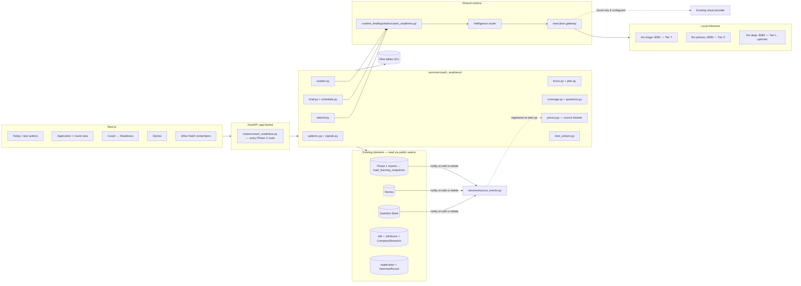
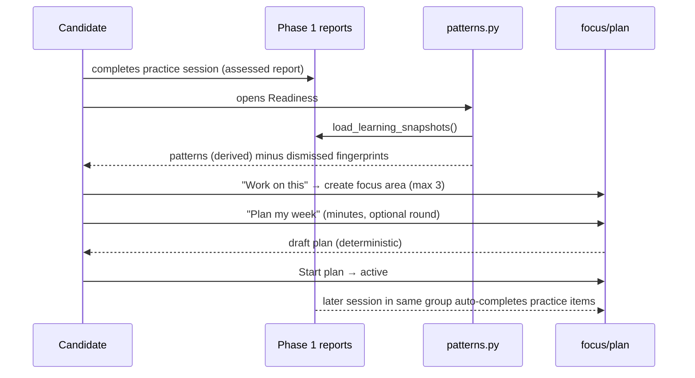
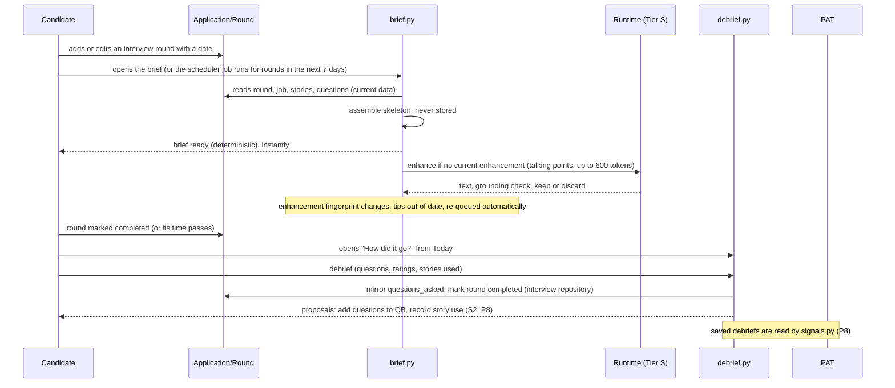
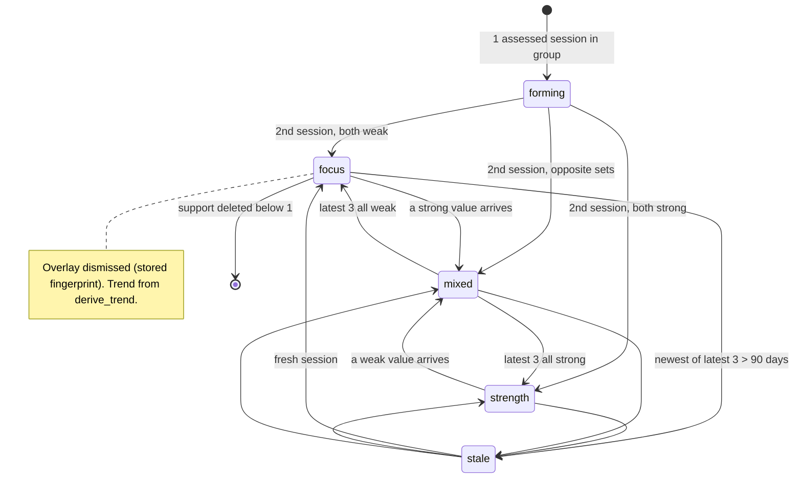
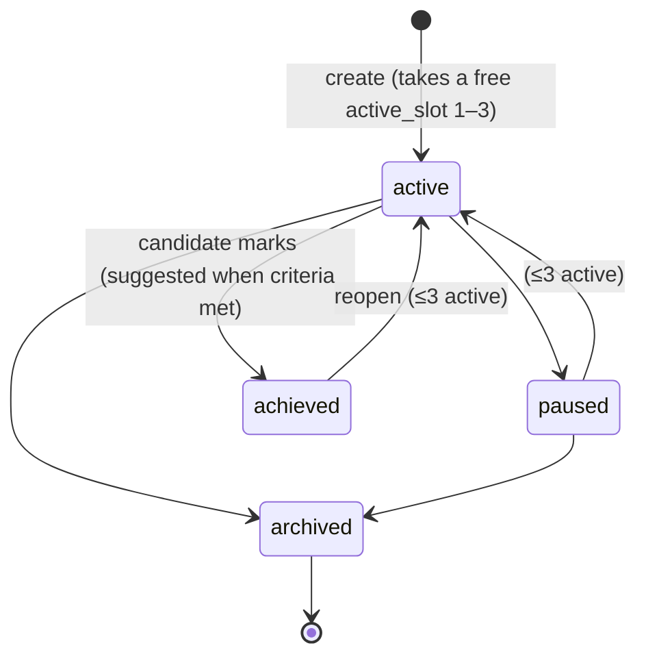
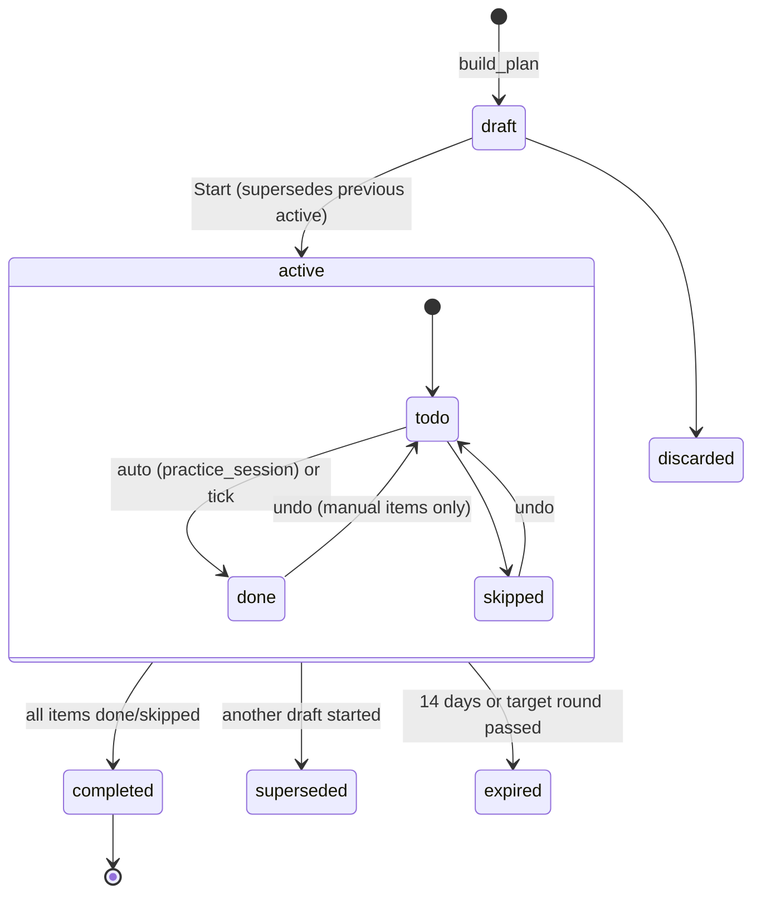
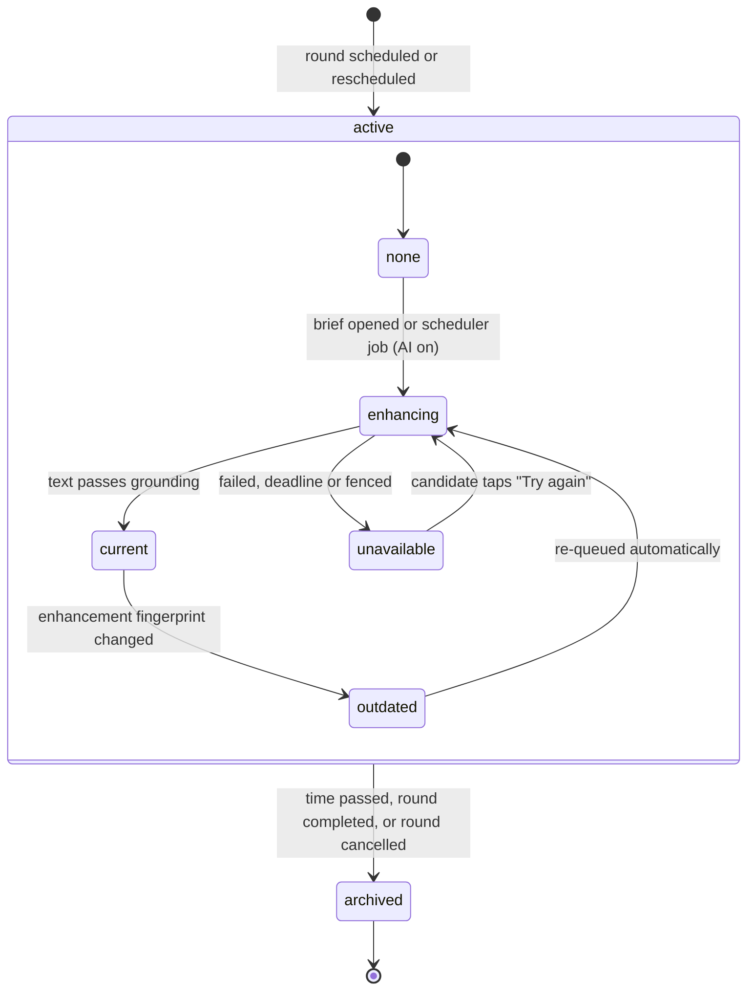
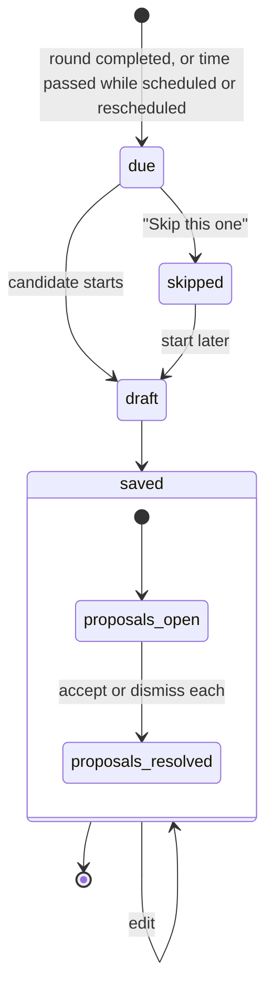
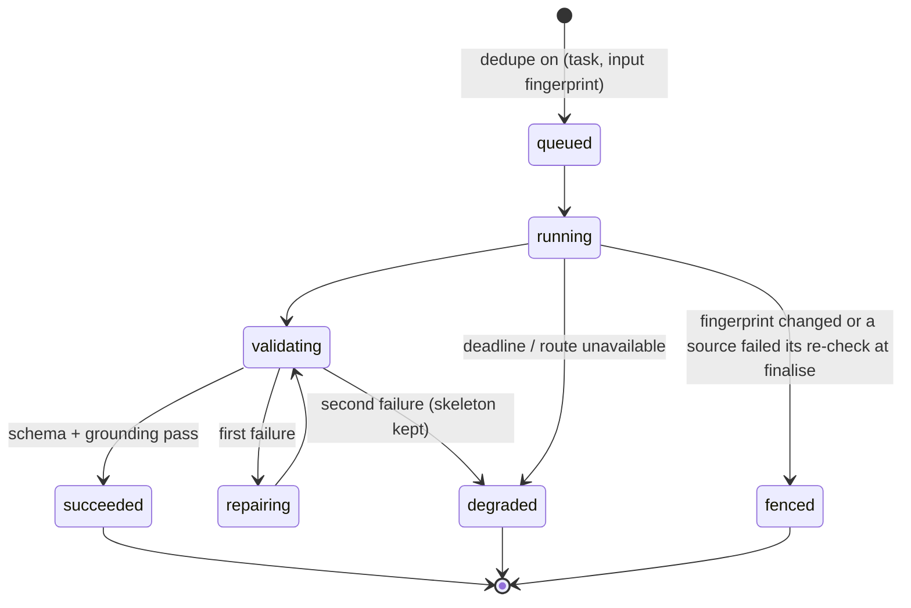
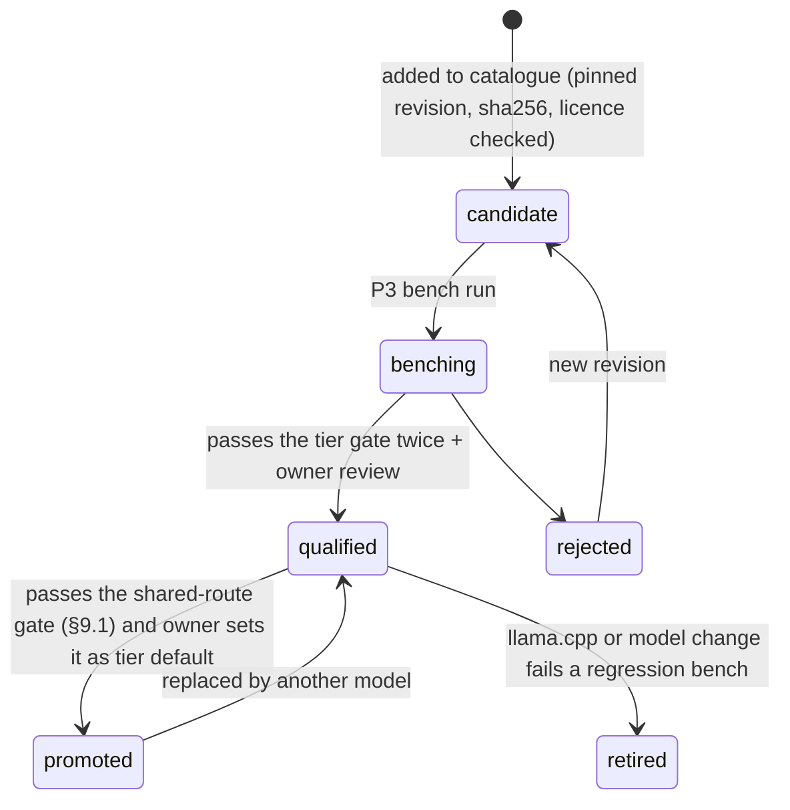

# Hatch Coach Phase 2 — Interview Readiness Loop

**Date:** 22 October 2026
**Status:** Final for implementation (owner decision, 2 Nov 2026). Changes go into this file, not addenda.
**Delivery:** OpenCode (Go subscription) writes code. Claude Code reviews every PR and writes the failing contract tests first for high-assurance tasks.
**Normative document:** this file. The plan sequences it; the HTML page only illustrates it. If they disagree, this file wins and the others are corrected.

## 0. Owner decisions (22 Oct and 2 Nov 2026)

| ID | Decision | Consequence |
|---|---|---|
| D1 | Phase 2 is a narrow "readiness loop", not the 13-PR v1 draft | v1's M7 Mentor threads, M9 cost routing, S2–S4 are dropped (§2.3) |
| D2 | New features in scope: pre-interview brief, real-interview debrief, story coverage map | Retry-and-compare is out |
| D3 | Mentor becomes single-turn "Explain" on a pattern | No threads, no message retention, no thread deletion fencing |
| D4 | Local runtime models are chosen by bench-gated tiers | Spark-X2.6-4B, MiniCPM 4.7/5 and others are candidates, not defaults, until they pass §9 |
| D5 | Deliverables: dated Markdown spec + plan, plus an HTML companion | One normative document (this one) |
| D6 | Wave 0 starts now; foundation R7–R9 are paused with no committed date | Wave 1 no longer waits for R9; it uses the readiness check in §3.2 |
| D7 | 90-day pattern window and 14-day plan expiry accepted | Config defaults in §7.1.2 and §8.3 |
| D8 | Brief archives at `scheduled_at + duration` (60 min when unset) | §7.5 |
| D9 | Delivery patterns (former S1) deferred | Moved to §2.2; AC26 deferred |
| D10 | Claude Code replaces Codex as reviewer and high-assurance test author (2 Nov 2026) | §16; plan §1 |
| D11 | Screen designs approved as the UI reference (2 Nov 2026) | §13.3a; `docs/visual-evidence/coach-phase2-design/` |
| D12 | A soft-deleted story or an archived Question Bank item is treated as deleted (2 Nov 2026) | Derived text citing it is purged and generation is fenced (§5.3, §7.8) |
| D13 | The brief skeleton is always assembled fresh; only model tips can go out of date, and they re-queue automatically (2 Nov 2026) | No stored skeleton and no Refresh button (§7.5, §8.4) |
| D14 | Tiers T and S share the existing `llm-triage` and `llm-primary` routes; promotion needs both the Phase 2 gate and the route's existing regression bench (2 Nov 2026) | Dual gate (§9.1) |
| D15 | Round times are stored as UTC and shown in a Hatch display timezone that defaults to the browser's (2 Nov 2026) | §7.5 |
| D16 | Existing domains report source changes through a neutral `source_events` hook and never import `coach_readiness`; every Phase 2 route lives in the readiness router; Today merges readiness actions in the frontend (2 Nov 2026) | §5.1–§5.3, §12 |
| D17 | Real-interview signals are derived on read from debriefs and ship in P8 (2 Nov 2026) | §7.1.5 |

All open questions from the 22 Oct draft and the 2 Nov review are resolved (§17).

## 1. Purpose and outcome

Hatch already practises, evaluates and stores interviews (Phase 1). What it lacks is the loop that turns that evidence into readiness for a **real, scheduled interview**, and learns back from how that interview went.

**Outcome:** before each real interview the candidate has a one-page brief built from their own evidence; after it, a two-minute debrief feeds the next one.

```
practice → patterns → focus → plan → brief → real interview → debrief ─┐
   ▲                                                                   │
   └───────────────────────────────────────────────────────────────────┘
```

### 1.1 Success measures (user #1, measured over the first 30 days after rollout)

| Measure | Target |
|---|---|
| Brief ready before a scheduled interview | ≥ 24 h before, for every round with `scheduled_at` set ≥ 24 h ahead |
| Debrief captured | Within 72 h for ≥ 80 % of completed rounds |
| Time to first useful pattern | Visible after the 2nd assessed session in a group (§7.1) |
| AI-off usefulness | Every M-feature renders useful content with AI mode = None |
| Local latency | Every model-backed action returns or degrades within its tier deadline (§9.3) on the reference machine |

## 2. Scope

### 2.1 MoSCoW

| ID | Priority | Deliverable | AC |
|---|---|---|---|
| M1 | Must | **Patterns**: recurring strengths/focus areas from practice, derived on read | AC01–AC05, AC37–AC38 |
| M2 | Must | **Focus areas** (goals-lite): max 3 active, template criteria | AC06–AC07, AC31 |
| M3 | Must | **Practice plan**: deterministic, time-boxed, interview-aware | AC08–AC09 |
| M4 | Must | **Story coverage map**: job competencies vs Story Bank | AC10–AC11 |
| M5 | Must | **Pre-interview brief** per interview round | AC12–AC15, AC32–AC33 |
| M6 | Must | **Real-interview debrief** per interview round | AC16–AC18 |
| M7 | Must | **Explain**: single-turn tips on a pattern | AC19 |
| M8 | Must | **Local model tiers** with bench gate, catalogue and routing changes | AC20–AC22, AC34–AC35 |
| M9 | Must | **"What Hatch remembers"** page and derived-data deletion cascade | AC23–AC25, AC29–AC30, AC36 |
| S2 | Should | Debrief → Question Bank and Story-use proposals | AC27 |
| S3 | Should | Brief print layout (browser print; PDF stays capability-gated) | AC28 |

All Musts form the release. Shoulds ship in the same phase if time allows, otherwise are noted as deferred in release notes.

### 2.2 Won't (this phase)

Delivery patterns for voice sessions (former S1, deferred by D9); persistent Mentor threads; managed routing (OpenRouter), Laya/Clef advisors, spend-reservation ledger; global (cross-role) findings; automatic plan adaptation; retry-and-compare; personas, panels, video, emotion or personality inference; calendar writes; phone app; model training on user data; any new service, container type, vector store or agent framework (an *optional* third llama-server instance in §9.2 reuses the existing image).

### 2.3 What changed from the v1 draft (13 Oct)

| v1 draft | This spec | Why |
|---|---|---|
| Findings persisted as revisions; accept/edit/reject each | Patterns **derived on read** from Phase 1 reports; only dismissals stored | Deletion propagates for free; no review fatigue |
| Grouping by exact `compatibility_key` | Group by role family + interview type + rubric version (§7.1) | The key hashes difficulty and locale too; raising difficulty split evidence, so findings rarely fired |
| `owner_key` on every table | None — single-user, app-locked API, same as Phase 1 | No `owner_key` exists anywhere in the repo at b7274a6 |
| Persistent Mentor (90-day threads) | Single-turn Explain | Commoditised by general assistants; most expensive privacy surface |
| M9 cost routing, spend ledger, routing experiment | Existing router + local tiers; cloud keeps existing budgets | Default runtime is local (USD cost 0) |
| Deadlines 90–180 s, 3–4k output tokens | Tier deadlines from bench; outputs ≤ 600 tokens | Contradicted Phase 1's own 120–300 s CPU deadlines |
| Model output proposes everything; 6 approval gates | HITL only where the action writes elsewhere or changes what you practise | HITL principle is about external/consequential actions |
| 13 PRs, 26 ACs | 10 PRs (2 waves), 37 ACs (AC26 deferred), smaller each | Phase 1 needed ~10 repair PRs; keep each PR small |

## 3. Grounding and prerequisites

### 3.1 Repository facts at b7274a6 (16 Oct 2026)

| Fact | Where | Use in Phase 2 |
|---|---|---|
| Phase 1 acceptance closed 14 Oct (#77–#79); R6 merged 16 Oct (#80) | git log | R7, R8, R9 open and paused (D6) |
| `ProgressSnapshot` carries `role_family`, `role_level`, `interview_type`, `dimensions`, `strengths`, `priorities`, `completed_at` | `services/coach_conversational_progress.py` | Pattern source (add rubric version + difficulty, §7.1.6) |
| `derive_trend(levels)` over latest 3 assessed | same | Reused for pattern trend |
| Levels `needs_work < developing < interview_ready < strong`, plus `not_assessed` | `services/coach_conversational_contracts.py` | Pattern rule |
| Content dimensions: relevance, structure, specificity, impact, role_depth, clarity, conciseness | same | Pattern dimensions |
| Delivery families: pace, fillers_per_minute, long_pauses, hedging, restarts; severity none/moderate/material/severe | `schemas/coach_conversation.py` | Deferred (D9) |
| Coach interview types: behavioural, role_specific_verbal, mixed; difficulty supportive < realistic < challenging | same | Grouping, improvement guard |
| `compatibility_key` = hash(role family, role level, interview type, difficulty, rubric contract, locale) | `services/coach_session_plan.py:836-843` | Kept for Phase 1 trend charts only |
| `InterviewRound` has `scheduled_at`, `duration_minutes`, `type`, `interviewer_name`, `feedback`, `prep_notes`, `questions_asked`, `status` (scheduled/completed/cancelled/rescheduled) | `models/application.py` | Brief + debrief anchor |
| Application status `applied → interview → offered/rejected/withdrawn` | `services/application_service.py` | Brief trigger |
| Story Bank: STAR+R, `tags`, `skills`, `metrics`, `strength_score`, `is_active`, `embedding`; `StoryMatcher` (Jaccard + cosine); `/stories/{id}/record-use`; `StoryRepository.update` and `soft_delete` | `models/story.py`, `services/story_*.py`, `routers/stories.py` | Coverage map and brief use their own containment score (§7.4), not `StoryMatcher`; hook call sites (§5.3) |
| Question Bank items with `skills`, `tags`, `role_family`, `linked_applications`, archive flag (no hard delete); `update_question_bank_item`, `archive_question_bank_item` | `models/question_bank.py` | Brief, debrief proposals; hook call sites (§5.3) |
| `Job.skills`; `JobScore.keyword_matches/keyword_misses/strengths/score_gaps` | `models/job.py`, `models/job_score.py` | Competency list |
| `CompanyResearch` table | `models/coach_session.py` | Brief "questions to ask" |
| `/applications/next-actions` returns prioritised actions | `routers/applications.py` | Today surface; unchanged, merged with readiness actions in the frontend (§7.5) |
| `InterviewRound.scheduled_at` is stored without a timezone; the calendar export treats it as UTC | `models/application.py`, `interviews_ical.py` | Time rule (§7.5) |
| Hard deletion is claim-based: `claim_hard_deletion` sets `deletion_state = 'deleting'`, a worker calls `finalise_hard_deletion`; `delete_attempt_transcript` removes a transcript | `repositories/conversational_session_repository.py` | Hook call sites and fencing (§5.3, §7.8) |
| Local catalogue has 2 pinned models; discovery policy allows publishers bartowski/unsloth and families qwen*/llama-3.2/gemma-3, and requires "instruct"/"chat" in the repo name | `config/model_catalog.json`, `config/model_discovery_policy.json` | M8 changes |
| llama.cpp image is `ghcr.io/ggml-org/llama.cpp:server` (rolling) for `llm-primary` :8080 and `llm-triage` :8081 | `docker-compose*.yml` | M8 pins a build |
| Coach stage timeouts 120–300 s; session create job 2,400 s | `config.py` | Tier deadlines |

### 3.2 Entry gates and waves

The foundation plan's R7–R9 are paused (D6). Phase 2 therefore does not wait for the R9 report. It needs only what already exists at b7274a6: the generic runtime (R0–R5), runtime bindings proven by Job Score and CV Tailor (R5, R6), and a green Phase 1 suite.

**Wave 1 readiness check** (recorded at the start of P4, replaces the R9 gate):
1. Phase 1 acceptance, privacy and recovery suites pass on current `main`.
2. `tests/runtime` passes, and the Job Score or CV Tailor binding still executes through the gateway in its integration test.
3. No open branch modifies the existing files Phase 2 touches: `conversational_session_repository.py`, `coach_conversational_progress.py`, `repositories/story_repository.py` and `services/question_bank.py` (§5.3).
4. P0–P3 merged; P3 bench report accepted by the owner.

Phase 2 adds model calls only through its own TaskSpecs. Phase 1 Coach execution stays on its current path and is not migrated by this phase.

| Wave | Starts | PRs | Touches R7/R8 files? |
|---|---|---|---|
| **Wave 0** | Now | P0 docs + bench harness, P1 coverage map, P2 debrief capture, P3 model catalogue/tier config | No |
| **Wave 1** | After the Wave 1 readiness check passes | P4 patterns, P5 focus + plan, P6 runtime bindings + cascade, P7 brief, P8 debrief extraction + proposals, P9 privacy page + acceptance | Reads via narrow seams only |

**Consequence for a later R8:** if R8 is resumed after Phase 2, it must carry forward the Phase 2 seams in Phase 1 code: `load_learning_snapshots` and the two snapshot fields (§7.1.6), and the three `source_events.notify` calls in `conversational_session_repository.py` (§5.3). R8's plan should list them as preserved behaviour.

## 4. Design principles

1. **Deterministic skeleton, model garnish.** Every feature is complete without a model. A model only rewrites or summarises supplied content into short text. AI mode = None must still give a useful brief, patterns, plan and coverage map.
2. **Derive, don't store.** Anything computable from Phase 1 reports, stories, jobs or rounds is computed on read. Only user decisions and user-authored content are stored, plus a cache of model text that cascades on source deletion.
3. **Keep evidence kinds separate.** Practice levels, real-interview self-ratings and story coverage are never averaged or merged into one score. No readiness percentage.
4. **Calibrated human-in-the-loop.** Observations appear without approval and can be dismissed. Explicit confirmation is required only when an action writes into another domain (Question Bank, Stories) or changes what the candidate practises (starting a plan).
5. **CPU-first budgets.** Short outputs (≤ 600 tokens), short prompts, thinking off (§9.1), deadlines measured on the reference machine (§9).
6. **No new infrastructure.** Reuse FastAPI, SQLite/Alembic, the shared runtime, existing llama.cpp images, existing app lock. No `owner_key`; Phase 1 has none.
7. **Language users understand.** UI never shows "finding", "compatibility key", "evidence state" (glossary in §13.4).

## 5. Architecture



### 5.1 Ownership and dependency direction

| Layer | Owns | Must not |
|---|---|---|
| `services/coach_readiness/*` | Pattern rules, focus/plan logic, coverage scoring, brief assembly, debrief logic, validation of model text, readiness next actions | Write Phase 1, Story, QB or Application tables directly; it writes other domains only through their public services |
| Existing domains (Phase 1 Coach, Stories, Question Bank, Applications) | Their tables and public services | Import anything from `coach_readiness` |
| `services/source_events.py` (new, neutral) | The source-change hook registry (§5.3) | Hold domain policy |
| `runtime_bindings/tasks/coach_readiness.py` | TaskSpecs, prompts, output schemas | Hold domain policy |
| Generic runtime | Routing, execution, deadlines, retries, lineage | Know any Coach concept |

Dependencies point one way: `coach_readiness` → existing domains → `source_events`. A reviewer treats any import of `coach_readiness` from an existing domain as a High finding.

### 5.2 File boundaries (proposed paths)

| Path | Responsibility |
|---|---|
| `backend/app/services/source_events.py` | Neutral hook registry: source kinds, `SourceChange`, `register_listener`, `notify` |
| `backend/app/services/coach_readiness/contracts.py` | DTOs, enums, limits, error codes |
| `.../patterns.py` | Pattern derivation (pure) + dismissal overlay |
| `.../signals.py` | Real-interview signals derived from debriefs (pure) |
| `.../focus.py` | Focus areas and criteria evaluation |
| `.../plan.py` | Practice plan builder (pure) and item completion |
| `.../coverage.py` | Competency list + story coverage (pure, deterministic) |
| `.../questions.py` | Likely-question selection shared by brief and debrief (pure) |
| `.../brief.py` | Brief assembly (pure skeleton) + enhancement orchestration |
| `.../debrief.py` | Debrief commands and proposals |
| `.../explain.py` | Explain request, cache, validation |
| `.../grounding.py` | Deterministic checks on model text (ids, numbers, length) |
| `.../privacy.py` | Inventory, deletion cascade, the `source_events` listener |
| `.../next_actions.py` | Readiness next actions for Today (§7.5) |
| `.../scheduler.py` | The upcoming-brief job function, registered on the existing APScheduler instance in `main.py` lifespan (§7.5) |
| `backend/app/models/coach_readiness.py` | New tables only |
| `backend/app/repositories/coach_readiness_repository.py` | Persistence |
| `backend/app/schemas/coach_readiness.py` | HTTP contracts |
| `backend/app/routers/coach_readiness.py` | All Phase 2 routes, including brief and debrief (§12) |
| `backend/app/runtime_bindings/tasks/coach_readiness.py` | TaskSpecs (§10) |
| `backend/app/config/model_tiers.json` | Tier → route → promoted model map (§9) |
| `frontend/src/app/coach/readiness/` | Readiness pages |
| `frontend/src/components/coach/readiness/` | Components |
| `frontend/src/lib/coachReadinessApi.ts` | Typed client |

### 5.3 Cross-domain hooks (`source_events`)

Existing domains must tell Phase 2 when a source it built text from changes, without importing it. `services/source_events.py` is the only shared seam:

```python
SourceKind = Literal["coach_session", "story", "question_bank_item", "job", "interview_round"]
ChangeKind = Literal["deleted", "edited", "deactivated"]

@dataclass(frozen=True)
class SourceChange:
    kind: SourceKind
    source_id: str
    change: ChangeKind

class SourceChangeListener(Protocol):
    async def on_source_change(self, session: AsyncSession, change: SourceChange) -> None: ...

def register_listener(listener: SourceChangeListener) -> None: ...
async def notify(session: AsyncSession, change: SourceChange) -> None:
    """Call every registered listener with the caller's session, inside the caller's transaction."""
```

- Listeners run inside the caller's transaction and must not commit. A listener error rolls the source change back, so a deletion never succeeds while derived text survives.
- **`notify` is the first write in the method, before any irreversible step** (removing an audio file or other media, calling an external service). `delete_attempt_transcript` and `finalise_hard_deletion` remove media; if `notify` ran after that, a listener failure would roll the database back but the media would already be gone. A listener only deletes rows, so a failure at that point leaves nothing to undo.
- The readiness listener is registered once at application start-up in the existing composition root (`main.py` lifespan), not by the existing domains.
- Call sites (each in the same transaction as the change it reports):

| Caller (existing domain) | When | `SourceChange` |
|---|---|---|
| `ConversationalSessionRepository.delete_attempt_transcript` | Transcript deleted | `coach_session`, `edited` |
| `ConversationalSessionRepository.claim_hard_deletion` | Hard deletion claimed (session row still exists) | `coach_session`, `deactivated` |
| `ConversationalSessionRepository.finalise_hard_deletion` | Session physically deleted | `coach_session`, `deleted` |
| `StoryRepository.update` | Story edited | `story`, `edited` |
| `StoryRepository.soft_delete` | Story deactivated (D12: treated as deleted) | `story`, `deleted` |
| `services/question_bank.update_question_bank_item` | Item edited | `question_bank_item`, `edited` |
| `services/question_bank.archive_question_bank_item` | Item archived (D12: treated as deleted) | `question_bank_item`, `deleted` |

- The readiness listener deletes `coach_derived_text` rows whose `coach_derived_sources` include the source, for every `ChangeKind`. Text is cheap to regenerate; keeping it after an edit risks showing claims the source no longer supports.
- Interview rounds and applications are not on this list: briefs, debriefs and overrides are removed by foreign-key cascade (§11).

## 6. Dataflow

### 6.1 Practice → patterns → focus → plan



### 6.2 Interview round → brief → debrief



## 7. Feature specifications

### 7.1 M1 — Patterns

#### 7.1.1 Group

`group = (role_family, interview_type, evaluation_contract_version)`.
Role level, difficulty and locale are **not** in the group; they are shown on each supporting session. A session without `role_family` falls into `role_family = "unspecified"`.

Trade-off: a coarser group gets evidence sooner but compares answers given at different difficulties. Mitigation in §7.1.4.

#### 7.1.2 Rule (per group × content dimension)

1. Take the group's eligible sessions (§7.1.6), newest first by `completed_at`, ties by session id. Keep the latest **3** that have an assessed value for the dimension. The freshness window does **not** filter sessions.
2. `not_assessed` values are ignored. Count distinct sessions, never attempts.
3. Classify the kept values:
   - **focus** — ≥ 2 values in {needs_work, developing} and none in {interview_ready, strong}
   - **strength** — ≥ 2 values in {interview_ready, strong} and none in {needs_work, developing}
   - **mixed** — ≥ 1 from each set
   - **forming** — exactly 1 assessed value ("1 of 2 sessions")
4. `trend = derive_trend(levels oldest → newest)` (existing function).
5. **Stale**: when the newest kept session is older than the freshness window (default **90 days**, config `HATCH_COACH_PATTERN_WINDOW_DAYS`) the pattern keeps its kind but is marked `stale`: shown greyed under "Older", never used by plans, briefs or Explain.

#### 7.1.3 Fingerprint and dismissal

`fingerprint = sha256(group, dimension, kind, sorted supporting session ids)`.
Dismissing stores the fingerprint only (no text). When new evidence changes the supporting set, the fingerprint changes and the pattern reappears labelled "Seen again since you dismissed it". Dismissal can be undone.

#### 7.1.4 Difficulty guard on trends

Difficulty order: supportive < realistic < challenging.

- `improving` is shown as **Improving** only when the newest session's difficulty ≥ the oldest kept session's difficulty; otherwise "Changed at an easier difficulty".
- `declining` is shown as **Getting weaker** only when the newest session's difficulty ≤ the oldest kept session's difficulty; otherwise "Lower at a harder difficulty".
- `mixed`, `stable` and `not_enough_evidence` trends show no trend label.

#### 7.1.5 Real-interview signals (P8; shown separately)

Signals are derived on read from saved debriefs (§7.6); nothing extra is stored.

- **Tagging a debrief question** (deterministic, in `signals.py`): the question's competency keys are the union of (a) the `skills` and `tags` of the Question Bank item it came from, when it was ticked from the likely-question list (`source_ref`), and (b) every competency in that application's coverage list (§7.4) whose normalised key is contained in the question's normalised text. A question with no keys contributes nothing.
- **Signals per competency key**, across all saved debriefs: "Asked in N real interviews" (N = distinct rounds) and "You rated yourself 2 or less in N debriefs". A signal appears when N ≥ 2.
- Signals never change practice patterns. They are labelled "From your real interviews" on Readiness (§13.1) and may fill brief watch-outs (§7.5) only after P8 ships; before that, those places show practice data only.

#### 7.1.6 Loading pattern sources

Patterns need every eligible session across all groups, which the existing `ProgressSelector` cannot express (its filtered mode requires at least one filter and has no "unspecified" role family).

- Add one read method to `ConversationalSessionRepository`: `load_learning_snapshots(*, limit: int = 1000) -> list[ProgressSnapshot]` — owned, completed `conversational_v1` sessions with a current report, newest first, excluding any session whose `deletion_state` is not `not_requested`.
- Add `evaluation_contract_version: str` (from `report_contract_version`) and `difficulty: str | None` (from `session_plan_json.interview.difficulty`) to `ProgressSnapshot`, defaulting so existing callers are unaffected.
- These, plus the `source_events.notify` calls in §5.3, are the only Phase 2 changes to `conversational_session_repository.py`. Existing progress methods and selectors are unchanged.

#### 7.1.7 Interfaces

```python
def derive_patterns(
    snapshots: Sequence[ProgressSnapshot],
    dismissed: frozenset[str],
    policy: PatternPolicy,          # window_days=90, max_sessions=3
    now: datetime,
) -> tuple[Pattern, ...]: ...

@dataclass(frozen=True)
class Pattern:
    fingerprint: str
    group: PatternGroup             # role_family, interview_type, contract_version
    dimension: str
    kind: Literal["focus", "strength", "mixed", "forming"]
    trend: Trend
    trend_label: Literal["improving", "easier_difficulty", "getting_weaker", "harder_difficulty"] | None
    supporting: tuple[SupportingSession, ...]   # id, completed_at, level, difficulty, role_level
    stale: bool
    dismissed: bool
```

### 7.2 M2 — Focus areas

- Created from a pattern ("Work on this") or manually. **Max 3 active**, enforced in the database (§11: `active_slot` 1–3 with a unique index).
- Fields: `title` (1–80 chars), `dimension` (one of the seven content dimensions), optional `group`, optional `application_id`, `criteria`, `status`, `version`, `active_slot`.
- Criteria templates (no free-form builder):
  - **Level**: "Reach interview_ready or better in {dimension} in 2 practice sessions" — counts assessed sessions in the focus area's group completed after it was created; N fixed at 2. **Requires a group**: a focus area created from a pattern takes the pattern's group; a manual one must pick a group to use this criterion.
  - **Practice**: "Finish N plan items" — N 1–10. Allowed with or without a group.
- Criterion status (derived): `not_started`, `in_progress`, `met`, `no_evidence_yet`.
- Focus status (stored): see §8.2. Only the candidate marks **Achieved**; the UI suggests it when all criteria are `met`.
- Edits use optimistic concurrency (`expected_version`); a stale edit returns 409 and the UI keeps the draft.

### 7.3 M3 — Practice plan

Inputs: active focus areas, optional target interview round, minutes (default **30**, range 10–120), now.

Item types:

| Type | What it does | Minutes | Completion |
|---|---|---:|---|
| `practice_session` | Opens Phase 1 session setup prefilled with the group (role family, interview type) and difficulty ≥ last used | 15 | **Auto**: one completed session in a group completes **every** open practice item for that group started before it |
| `story_work` | Opens a story (or a new story) for a gap competency from M4 | 10 | Manual tick |
| `review_answer` | Opens a Question Bank item for a likely question | 5 | Manual tick |

Rules (pure function `build_plan`):
1. **Eligible focus areas:** active, not all criteria `met`. Focus areas sharing a group share **one** `practice_session` item. A focus area with no group gets no practice item (its criteria can be met by the other items).
2. **Candidate items**, one list:
   - With a target round less than **7 days** away: `story_work` for its top coverage gap, then `review_answer` for its first likely question without an answer, then the second `story_work`, then practice items.
   - Otherwise: practice items first (ordered by the earliest-created focus area in each group, then id), then story and review items if a target round exists.
3. Walk the list once, adding each item that fits the remaining minutes; never exceed the budget; report unallocated minutes. Max 6 items.
4. **Deadlines:** with a target round, every item's `due_at` = `scheduled_at` − 2 h. A round less than 2 h away cannot be a plan target: `build_plan` returns `invalid_input` and the UI says "Too close to the interview for a plan. Open the brief instead."
5. Wording is template text. A Tier S model may rewrite item titles (§10) but cannot change type, minutes, order or targets.

One plan is `active` at a time. A new draft supersedes the active plan only when the candidate starts it.

### 7.4 M4 — Story coverage map

**Competency list for an application (deterministic):**
1. `JobScore.keyword_misses` (gaps first), then `JobScore.keyword_matches`, then `Job.skills`.
2. For each, a **match key**: lowercase, trim, collapse whitespace, remove stop words (the existing `backend/benchmarks/coach/fixtures/stopwords_en.txt` list, copied to `services/coach_readiness/stopwords_en.txt`). De-duplicate by match key; cap at **12**. The match key is never shown; the UI shows the first-seen original text.
3. Optional Tier T extraction (P8) may add up to 4 competencies from the description when the list has < 5; extracted items are labelled "from the job description".

**Coverage (deterministic, no model, no embeddings):**
- A story's word set = match-key words of its `tags`, `skills` and `title`.
- `score(competency, story)` = |competency words ∩ story words| / |competency words| (containment, 0–1). A one-word competency that appears in a story's tags scores 1.0.
- The best two stories by score, ties by `strength_score` then id, are kept.

| Status | Rule (config `HATCH_COACH_COVERAGE_COVERED_MIN` = 0.67, `HATCH_COACH_COVERAGE_THIN_MIN` = 0.34; P1 calibrates on fixtures) |
|---|---|
| `covered` | best score ≥ covered_min **and** that story has a `result` |
| `thin` | best score ≥ thin_min and not `covered` |
| `gap` | best score < thin_min |

`has_metric` (the story's `metrics` is non-empty) is shown as information only and does not change status.

Output per competency: status, up to 2 stories (id, title, score, has_metric), and an action: "Use this story" / "Strengthen this story" / "Draft a story". Also an overview across all active applications in `interview` status: competencies that are gaps in ≥ 2 applications. Only active stories count (`is_active = true`).

No new table: computed on read; competency overrides (rename, hide) are stored in `coach_competency_overrides` (§11).

### 7.5 M5 — Pre-interview brief

**Anchor:** one brief per `InterviewRound`. If an application is in `interview` with no round, Today shows "Add your interview date to get a brief"; the brief can still be built without a date.

**Times:** `InterviewRound.scheduled_at` is stored without a timezone. Phase 2 treats it as **UTC**, the rule the calendar export already uses (`interviews_ical.py`). The API returns ISO 8601 with `Z`; the UI shows times in the display timezone (D15): `HATCH_DISPLAY_TIMEZONE` (IANA name) when set, else the browser's timezone, with the zone abbreviation. P2 checks how the existing round form submits `scheduled_at`. If it sends browser-local time without an offset, the fix is **in the frontend round form**: convert to UTC before sending, with a Vitest test. Readiness code cannot repair stored values and `routers/interviews.py` does not change. Existing rows stay as they are.

**Round type → practice interview types** (for watch-outs):

| `InterviewRound.type` | Practice `interview_type`s used |
|---|---|
| `behavioural`, `culture_fit` | `behavioural`, `mixed` |
| `technical`, `assessment`, `presentation` | `role_specific_verbal`, `mixed` |
| `phone_screen`, `panel`, `final` | all three |

The role family is taken from the most recent assessed practice session linked to the application (`application_id`). With none, the brief shows no practice watch-outs and says "Practise for this role to get watch-outs".

**Sections (skeleton, all deterministic):**

| # | Section | Source | Limit |
|---|---|---|---|
| 1 | Header | Application, Job, Round (type, time in display timezone, duration, location, interviewer) | — |
| 2 | Likely questions | `questions.likely_questions(application_id)`: QB items linked to the application → QB items in the role family → questions from the latest Phase 1 session plan for this application; archived items excluded | 5 |
| 3 | Your best stories | Coverage map `covered` stories, ranked by score then `strength_score` | 3, each mapped to competencies |
| 4 | Watch-outs | Active, non-stale `focus` patterns for the role family and mapped interview types, then (after P8) real-interview signals | 2 |
| 5 | Gaps | Coverage `gap` competencies | 2, each with "Draft a story" |
| 6 | Questions to ask them | `CompanyResearch` (if present) else a fixed template set by round type | 3 |
| 7 | Logistics | Round fields | — |

**The skeleton is never stored.** It is assembled on every read from current data, so it is always up to date (D13).

**Enhancement (optional, Tier S):** one talking point (≤ 30 words) per story in section 3 and one sentence (≤ 30 words) per watch-out. Total ≤ 600 output tokens. Validation (`grounding.py`): every talking point references a supplied story id; every number in the text appears in that story; no new names of companies, products or people; length limits. Failure → keep the skeleton, show "Tips unavailable", no retry beyond the runtime's one repair.

**Enhancement fingerprint:** hash of story ids and versions in section 3, watch-out pattern fingerprints, job description hash and round type. Stored enhancement text is shown only while its fingerprint equals the current one. When it differs, the brief shows "Tips out of date" and **automatically re-queues** one enhancement (dedupe per §10); the old text is not shown in the meantime.

**When enhancement runs:**
- When a brief is opened and has no current enhancement.
- From the readiness scheduler job (every 30 minutes, registered in `main.py` lifespan): for rounds scheduled in the next 7 days without a current enhancement, so a brief is ready ≥ 24 h before the interview (§1.1). The job is skipped when AI mode is None or the brief flag is off.

**Round status:**
- `scheduled` or `rescheduled` with `scheduled_at + duration` in the future → brief active.
- `scheduled_at + duration` passed, or round `completed` → brief `archived` (read-only); the debrief becomes due (§7.6).
- `cancelled` → brief `archived`; no debrief is due.
- A changed `scheduled_at` simply moves both times; nothing else resets.

**Today:** the readiness router serves `GET /coach/readiness/next-actions` ("Interview in 3 days — brief ready", "How did it go?", "Add your interview date to get a brief"). The Today page requests it alongside the existing `/applications/next-actions` and merges the lists in the frontend. The Applications domain does not change.

### 7.6 M6 — Real-interview debrief

**Due:** when the round is `completed`, or when `scheduled_at + duration` has passed and the round is `scheduled` or `rescheduled`. Never for `cancelled` rounds (an existing saved debrief is kept). Default duration 60 min when unset.

**Form (target: 2 minutes):**
- Overall feeling 1–5 (required to save); "Do you expect to progress?" yes / unsure / no.
- Questions asked: `questions.likely_questions(application_id)` appear as a checklist ("Were you asked this?") plus quick-add free text. Max 20 questions, each ≤ 200 characters.
- Per question (optional): self-rating 1–5, story used (picker over active stories), one-line note (≤ 200 characters).
- "Went well" and "Do differently" free text (≤ 1,000 characters each).
- Optional "Paste rough notes" (P8): the notes (≤ 2,500 characters) are saved in the draft debrief (`notes_text`) first; Tier T extraction then reads them by debrief id and proposes a question list the candidate confirms.

`questions_json` item: `{id, text, source_ref: {kind: "question_bank_item", id} | null, asked: bool, rating: 1–5 | null, story_id: str | null, note: str | null}`.

**Writes on save:**
- `coach_interview_debriefs` row (user-authored; §11).
- Mirror the asked question texts into `InterviewRound.questions_asked`, and set round status `completed` if it was `scheduled` or `rescheduled` — through the existing interview repository, not direct SQL.
- **S2 proposals** (P8; one batch card): "Add N new questions to your Question Bank" for asked questions with no `source_ref` whose normalised text is not already in the Question Bank, and "Record that you used story X" for each story used. Accept writes through `create_question_bank_item` and the existing story record-use path; dismiss stores nothing.

Debriefs are user-authored and are **not** deleted when a practice session is deleted. They are deleted with their round or application (FK cascade) or from the privacy page.

### 7.7 M7 — Explain

On a pattern card:
- **Why?** (deterministic, instant): the counts, dates, difficulty of each supporting session, and up to 2 report excerpts already stored in the Phase 1 report (`strengths` / `priorities` items for that dimension).
- **Tips** (Tier S): up to 3 bullets, each ≤ 40 words, ≤ 120 words in total, grounded on the dimension's rubric description and the supplied excerpts. No claims about the candidate beyond the excerpts. Cached by `(pattern fingerprint, prompt version, model identity)`; the cache is purged by the `source_events` listener when a supporting session is edited, deactivated or deleted (§5.3). Not offered for stale patterns.

No thread, no follow-up turns, no stored conversation.

### 7.8 M9 — What Hatch remembers

One page listing every kind of Phase 2 data with count, last updated and a delete control:

| Kind | Stored? | Delete effect |
|---|---|---|
| Patterns | No (derived) | Delete the practice sessions in Coach; link provided |
| Dismissed patterns | Fingerprints only | Clears dismissals |
| Focus areas, plans | Yes | Deletes rows |
| Briefs | Skeleton derived; enhancement text cached | Deletes cached text; the brief re-assembles |
| Debriefs | Yes, user-authored, including saved rough notes | Deletes rows; the round keeps `questions_asked` unless "also clear questions on the round" is ticked |
| Explain tips | Cached text | Deletes cache |
| Competency overrides | Yes | Deletes rows |

Plus "Delete all Coach readiness data" (confirm dialog). Phase 1 sessions are untouched by this page.

**Cascade and fencing:**
- Source changes reach Phase 2 only through `source_events` (§5.3), inside the source's own transaction. The readiness listener deletes every `coach_derived_text` row whose sources include the changed source.
- Hard deletion is claim-based: between `claim_hard_deletion` and `finalise_hard_deletion` the session row still exists with `deletion_state = 'deleting'`. The listener purges at claim time (`deactivated`) and again at finalise (`deleted`), and every readiness read excludes sessions whose `deletion_state` is not `not_requested`.
- Generation finalisation (§10) re-checks every source in the same transaction as the write: a session must still have `deletion_state = 'not_requested'` and the same `activity_version`; a story must be `is_active`; a Question Bank item must not be archived. Any failure → `fenced`, nothing written.
- Patterns need nothing: they disappear on the next read.

## 8. Status models

Statuses below are the only legal values; transitions not drawn are rejected with `invalid_state` (409).

### 8.1 Pattern (derived; not stored)



### 8.2 Focus area (stored)



### 8.3 Practice plan and item (stored)



### 8.4 Brief (stored row tracks enhancement and round state; skeleton always derived)

The skeleton has no status: it is rebuilt from current data on every read. The stored row tracks only the model enhancement and the round.



**State is derived on read.** `current` only when the enhanced-text row exists **and** its fingerprint equals the current enhancement fingerprint. If the text was purged by the `source_events` listener (`enhanced_text_id` is NULL), the state reads as `none` and, with AI on, one enhancement is re-queued. The stored `enhancement_state` column records only `enhancing` and `unavailable` and the last attempt; it never makes `current` true by itself.

UI labels: `none` and AI off → "Ready"; `enhancing` → "Adding tips"; `current` → "Ready · tips added"; `outdated` → "Tips out of date"; `unavailable` → "Tips unavailable"; `archived` → "Archived".

### 8.5 Debrief (stored)



A `cancelled` round never makes a debrief due. If a round is cancelled after a debrief was started or saved, the debrief is kept as it is.

### 8.6 Model generation (runtime; per request)



### 8.7 Local model qualification (catalogue `status` + bench reports)



The state is stored as `status` on each catalogue entry (§9.2).

## 9. M8 — Local model tiers

### 9.1 Tiers

| Tier | Route (shared) | Phase 2 tasks | Output cap | Candidates (bench order) |
|---|---|---|---|---|
| **T** tiny | `llm-triage` :8081 — also serves job-scoring triage | Debrief note extraction, competency extraction from the job description | 512 tokens | MiniCPM-V-4.7-1B (text-only), MiniCPM5-2B, Qwen3.5-0.8B (incumbent) |
| **S** small | `llm-primary` :8080 — also serves Phase 1 Coach, CV and cover letter | Explain tips, brief talking points, plan item wording | 600 tokens | Spark-X2.6-4B, Qwen3.5-4B (incumbent), MiniCPM5-2B, phi4-mini |
| **L** large (optional, off by default) | `llm-deep` :8082 (new, Phase 2 only) | Same as S when the owner opts in for richer wording | 600 tokens | MiniCPM-V-4.7-35B-A3B (MoE, ~3B active); gemma4:12b only if its licence is approved (§9.2) |

Rules:
- **Shared routes, dual gate (D14).** Each llama-server runs one model, so promoting a Tier T or Tier S model changes the model for every feature on that route. A model is promoted for T or S only when it passes **both** the Phase 2 tier gate (§9.4) **and** the existing route's regression bench on the same llama.cpp build: for Tier S, the Phase 1 Coach `acceptance-smoke` profile; for Tier T, the job-scoring triage checks in the representative local-model selection procedure (`docs/operations/REPRESENTATIVE_LOCAL_MODEL_BENCHMARK.md`). The P3 report records both results.
- Every Tier L task has a Tier S fallback; every Tier S/T task has a deterministic fallback. No feature requires L.
- **Thinking is off.** Both existing servers run with `--reasoning off`. P3 tests whether a per-request override (`chat_template_kwargs: {"enable_thinking": true}`) takes effect on the pinned build. If it does not, Phase 2 uses thinking off only and the bench measures nothing else. The adapter always strips reasoning text from outputs.
- **Context budgets.** `llm-triage` runs `--ctx-size 4096 --parallel 2`: 2,048 tokens per request. Tier T prompts must fit: instructions ≤ 300 tokens + input ≤ 1,200 tokens + output ≤ 512 tokens. `llm-primary` runs `--parallel 1`, so Phase 2 requests queue behind Phase 1 work; the absolute deadline (§9.3) includes queue time.
- Cloud: if the owner has configured a cloud provider, the router may use it for S/L under existing egress authorisation and budgets. No new cost machinery.

### 9.2 Runtime and catalogue changes

1. **Pin llama.cpp.** Replace the rolling `ghcr.io/ggml-org/llama.cpp:server` tag with a pinned build ≥ **b10828** (needed for Spark's `spark2_5` architecture). P3 records the exact tag and digest after the bench passes on it.
2. **Discovery policy** (`model_discovery_policy.json`): add publishers `xhtoken`, `openbmb`; families `spark-x2`, `minicpm`; accept repos in an allowlisted family without the "instruct"/"chat" marker; accept `image-text-to-text` for allowlisted families when used text-only (no mmproj download). `approved_licenses` stays as it is: Spark-X2.6, MiniCPM-V 4.7 and MiniCPM5 are Apache-2.0 and phi4-mini is MIT (P3 re-checks each model card). A model whose licence is not on the list (for example a Gemma licence) is not benched unless the owner adds the licence first.
3. **Pinned catalogue** (`model_catalog.json`): one entry per candidate with `repo_id`, `filename`, `source_revision`, `sha256`, `download_size_gb`, `min_ram_gb`, `recommended_ram_gb`, `license`, and two new fields: `tiers: ["T"|"S"|"L"]` and `status: "candidate"|"qualified"|"promoted"|"rejected"|"retired"`. Existing entries get `status: "promoted"` for their current role. Revisions and hashes are recorded in P3 from the actual files; none are pre-filled in this spec.
4. **Tier map** `config/model_tiers.json`: `{tier: {route, model_id, thinking, max_output_tokens, deadline_s}}`. Startup validation rejects any `model_id` whose catalogue `status` is not `promoted`. Exposed read-only in Settings.
5. **Optional `llm-deep`**: a third service in `docker-compose.local-ai.yml` under a `deep` profile, same image, port 8082, started only when the owner enables Tier L in Settings and RAM ≥ the model's `recommended_ram_gb`.
6. **Hardware gate:** Tier L is hidden when the probe's RAM < 24 GB. The installer's existing probe output is the source.

### 9.3 Deadlines

Initial values; P3 replaces them with measured values: `deadline = 1.5 × p95(measured end-to-end, including queue time)` rounded up to 10 s, capped by the maxima below.

| Tier | Initial deadline | Max deadline |
|---|---|---|
| T | 30 s | 60 s |
| S | 90 s | 180 s |
| L | 180 s | 300 s |

A deadline is absolute across the one allowed repair attempt.

### 9.4 Bench protocol (suite built in P0, runs in P3)

- Suite `backend/benchmarks/coach/fixtures/phase2_v1/` built in P0 from **synthetic** CVs, stories, job descriptions and debrief notes (no real candidate data): 15 explain, 15 brief-enhance, 10 debrief-extract, 8 competency-extract = **48 cases**, split 16 tuning / 32 holdout. Tier T cases respect the context budget in §9.1, and **at least a third of each task's cases are sized within 20 % of that task's input maximum** (Tier T: notes ≈ 2,500 characters, requirement text ≈ 4,500 characters; explain: three excerpts of several hundred characters; brief-enhance: three full-length stories), so latency, memory and context pressure are measured at realistic size.
- Run in P3 through the existing `python -m benchmarks.coach` harness with the `phase2` profile, against llama-server on the pinned build, loopback only. P0 supplies a **bench-only execution path** for the four tasks (a prompt per task, call to the loopback llama-server, output validation, metrics), so P3 does not wait for the P6 TaskSpecs. Grounding checks are implemented in P0 and re-exported from `grounding.py` in P6; the bench never reports "0 violations" from a stub.
- Two hardware profiles: **reference** (owner's laptop: 8 threads, 31 GiB RAM, 4 GiB VRAM; run CPU-only and with GPU offload) and **floor** (CPU-only, 4 threads, 8 GB RAM limit — T and S ≤ 4B Q4 only).
- Metrics per model × tier: schema-valid %, grounding violations (from the shared checks), p50/p95 latency, time-to-first-token, tokens/s, peak RSS, and owner's blind 1–5 rating of 10 random holdout outputs.

**Promotion gate (per tier, on holdout, two independent runs):**

| Criterion | T | S | L |
|---|---|---|---|
| Schema-valid | ≥ 98 % | ≥ 95 % | ≥ 95 % |
| Grounding violations | 0 | 0 | 0 |
| p95 latency on reference CPU-only | ≤ 30 s | ≤ 90 s | ≤ 180 s |
| Peak RSS | ≤ 3 GB | ≤ 6 GB | ≤ 20 GB |
| Owner blind rating mean | ≥ 3.5 | ≥ 3.5 | ≥ 3.8 |
| Floor profile | must pass T | must pass S, or incumbent stays S default on floor | n/a |

Ties go to the smaller RSS, then the incumbent. If no candidate passes, the incumbent stays. Results go to `docs/implementation-reports/coach-phase2/P3-local-model-bench.md`.

## 10. Runtime contracts

| TaskSpec (v1) | Tier | Input (references only) | Output schema | Fallback |
|---|---|---|---|---|
| `coach.readiness.explain` | S | pattern fingerprint, dimension, excerpt ids | `{tips: [str ≤ 40 words] ≤ 3}`, ≤ 120 words in total | "Tips unavailable" |
| `coach.readiness.brief_enhance` | S (L opt-in) | round id, enhancement fingerprint, story ids, pattern fingerprints | `{talking_points: [{story_id, text ≤ 30 words}] ≤ 3, watchouts: [{fingerprint, text ≤ 30 words}] ≤ 2}` | Skeleton only |
| `coach.readiness.plan_wording` | S | plan id, item ids | `{titles: [{item_id, text ≤ 12 words}]}` | Template titles |
| `coach.readiness.debrief_extract` | T | debrief id (its saved `notes_text`, ≤ 2,500 characters) | `{questions: [str ≤ 120 chars] ≤ 12}` | Manual entry |
| `coach.readiness.competency_extract` | T | job id, description hash | `{competencies: [str ≤ 40 chars] ≤ 4}` | Deterministic list only |

Common rules:
- Inputs are references; content is resolved by the binding's context provider at execution time and never persisted in runtime records, events, traces or logs. User text that a task needs (rough notes) is saved in the product's own table first and passed by id.
- `competency_extract` does not send the whole job description: the context provider sends the description's requirement-like lines (bullets and lines containing skill words), truncated to 1,200 tokens (§9.1).
- At most **one** generation plus **one** repair per request; provider SDK retries disabled or counted.
- Dedupe: while a request with the same `(task_id, input_fingerprint)` is queued or running, return its operation id.
- **Fencing at finalise:** in the same transaction as the write, recompute the input fingerprint and re-check every source as §7.8 requires (session not being deleted and same `activity_version`; story active; Question Bank item not archived; round not cancelled). Any failure → `fenced`, nothing written.
- Model text is plain text, rendered escaped. It never authorises a write.
- AI mode None → requests are not created; UI shows the fallback with "Turn on local AI for tips".

### 10.1 Interfaces fixed for the high-assurance tasks

These signatures are binding for P2, P6 and P9 and for the RED tests Claude Code writes before them. If a RED test needs an interface not listed here, `/phase2-red` records it in `PN-red.md` as an addition for the owner to approve before OpenCode starts.

```python
# services/source_events.py (P6) — see §5.3
async def notify(session: AsyncSession, change: SourceChange) -> None: ...
def register_listener(listener: SourceChangeListener) -> None: ...

# services/coach_readiness/privacy.py (P6, P9)
class ReadinessPrivacy(SourceChangeListener):
    def __init__(self, repository: CoachReadinessRepository) -> None: ...
    async def on_source_change(self, session: AsyncSession, change: SourceChange) -> None: ...
    async def inventory(self) -> MemoryInventory: ...                     # P9
    async def delete_kind(self, kind: MemoryKind) -> int: ...             # P9; returns rows removed
    async def delete_all(self) -> MemoryDeletionResult: ...               # P9

# services/coach_readiness/debrief.py (P2)
class DebriefService:
    async def get_or_due(self, round_id: str, now: datetime) -> DebriefRead | None: ...
    async def save(self, round_id: str, command: SaveDebriefCommand, now: datetime) -> DebriefRead: ...
    async def skip(self, round_id: str, expected_version: int, now: datetime) -> DebriefRead: ...

# services/coach_readiness/contracts.py — generation finalisation (P6)
@dataclass(frozen=True)
class SourceRef:
    kind: SourceKind
    source_id: str
    version: str          # activity_version, story version, QB updated_at, round updated_at

async def finalise_generation(
    session: AsyncSession, request: GenerationRequest, output: ValidatedOutput, now: datetime
) -> GenerationOutcome: ...   # succeeded | fenced; writes coach_derived_text + sources in one transaction
```

`SaveDebriefCommand` carries `expected_version`, `overall`, `expectation`, `questions` (the `questions_json` items of §7.6), `went_well`, `do_differently`, `notes_text`. `MemoryKind` is the closed set of rows in §7.8.

## 11. Persistence

Additive Alembic migration(s), one head, SQLite foreign keys on. Phase 1 tables are not altered; the Phase 1 changes are the read method and hook calls in §5.3 and §7.1.6.

| Table | Key columns | Notes |
|---|---|---|
| `coach_pattern_dismissals` | `fingerprint` PK, `dismissed_at` | No content |
| `coach_focus_areas` | `id` PK, `version`, `status`, `active_slot` nullable, `title`, `dimension`, `group_json` nullable, `application_id` FK nullable (SET NULL), `criteria_json`, timestamps | `CHECK status IN (...)`; `CHECK active_slot IN (1,2,3)`; `CHECK (status = 'active') = (active_slot IS NOT NULL)`; **unique index on `active_slot`** (NULLs allowed). Activating takes the lowest free slot; a unique-constraint conflict retries once, then returns `limit_reached` |
| `coach_practice_plans` | `id` PK, `version`, `status`, `minutes`, `target_round_id` FK nullable (SET NULL), `items_json`, `started_at`, `completed_at`, timestamps | One `active` row enforced by partial unique index `WHERE status='active'` |
| `coach_interview_briefs` | `id` PK, `interview_round_id` FK unique (CASCADE), `enhancement_state`, `enhancement_fingerprint` nullable, `enhanced_text_id` FK nullable (SET NULL), `archived_at` nullable, timestamps | Skeleton is not stored |
| `coach_interview_debriefs` | `id` PK, `interview_round_id` FK unique (CASCADE), `version`, `status`, `overall`, `expectation`, `questions_json`, `went_well`, `do_differently`, `notes_text` nullable, `proposals_json`, timestamps | User-authored |
| `coach_derived_text` | `id` PK, `kind` (explain/brief/plan_wording/extract), `cache_key` unique, `text_json`, `model_identity`, `prompt_version`, `created_at` | All model output lives here |
| `coach_derived_sources` | (`derived_text_id` FK CASCADE, `source_kind`, `source_id`) PK, `source_version` | Index on (`source_kind`, `source_id`) for the `source_events` listener |
| `coach_competency_overrides` | `id` PK, `application_id` FK (CASCADE), `match_key`, `display_text`, `replacement` nullable, `hidden` | User-authored |

`source_kind` is the closed enum from §5.3. Write commands that check a count or a version use a single transaction that starts with a write (SQLite takes the write lock at the first write), so two commands cannot both pass the check.

Interview round deletion and application deletion cascade to briefs, debriefs and overrides via FKs. P2 must confirm how application deletion currently removes `interview_rounds`; if it does not cascade, the debrief FK uses CASCADE from the round and P2 adds a test proving no orphan remains.

## 12. API

All under the existing authenticated prefix; app lock applies. Every Phase 2 route lives in `routers/coach_readiness.py`; no existing router changes. Errors use registered safe codes: `invalid_input` 422, `not_found` 404, `version_conflict` 409, `invalid_state` 409, `limit_reached` 409, `disabled` 403, `temporarily_unavailable` 503.

| Method and path | Purpose |
|---|---|
| GET `/coach/readiness` | Overview: patterns (grouped), active focus areas, active plan, upcoming rounds with brief state, due debriefs |
| GET `/coach/readiness/next-actions` | Readiness actions for Today (§7.5) |
| GET `/coach/readiness/patterns?group=&include_stale=` | Patterns |
| POST `/coach/readiness/patterns/{fingerprint}/dismiss` · DELETE same | Dismiss / undo |
| GET `/coach/readiness/patterns/{fingerprint}/why` | Deterministic explanation |
| POST `/coach/readiness/patterns/{fingerprint}/tips` | Explain; returns cached text or 202 + operation id |
| GET/POST `/coach/readiness/focus-areas` · PATCH `/{id}` (expected_version) | Focus areas |
| POST `/coach/readiness/plans` (draft) · POST `/{id}/start` · PATCH `/{id}/items/{item_id}` | Plans |
| GET `/coach/readiness/coverage?application_id=` · GET `/coach/readiness/coverage/overview` | Coverage map |
| PUT `/coach/readiness/coverage/{application_id}/overrides` | Rename/hide competencies |
| GET `/coach/readiness/rounds/{round_id}/brief` · POST `/coach/readiness/rounds/{round_id}/brief/tips` | Brief (always freshly assembled) and "Try again" for tips |
| GET/PUT `/coach/readiness/rounds/{round_id}/debrief` · POST `.../debrief/skip` · POST `.../debrief/extract` · POST `.../debrief/proposals/{id}/accept` | Debrief |
| GET `/coach/readiness/operations/{id}` | Generation status |
| GET `/coach/readiness/memory` · DELETE `/coach/readiness/memory/{kind}` · DELETE `/coach/readiness/memory` | Privacy page |

Pagination: default 20, max 100, stable order (timestamp, id). Request text limits as stated per feature; unknown fields rejected.

## 13. UI and UX

### 13.1 Information architecture

- **Coach → Readiness** (new tab beside Sessions and Stories): sections in this order — *Next interview* (brief card or "Add a date"), *Focus areas* (≤ 3), *This week's plan*, *Patterns* (by group), *From your real interviews* (signals, after P8).
- **Application detail → Interview round**: Brief and Debrief tabs on each round.
- **Stories**: coverage strip at the top ("3 gaps across your active interviews") with filter.
- **Today**: readiness actions from `GET /coach/readiness/next-actions`, merged with application actions in the frontend (§7.5), with deep links.
- **Settings → AI**: tier table (read-only model names, deadline, status) and the Tier L opt-in.
- **Settings → Privacy → What Hatch remembers** (§7.8).
- **Settings → General**: shows the display timezone in use (`HATCH_DISPLAY_TIMEZONE`, else "This browser: {zone}").

### 13.2 Interaction rules

1. **Instant first paint.** Every screen renders deterministic content immediately. Model text arrives later in place, with a quiet "Adding tips…" line, never a blocking spinner. If generation ends `degraded`, the line becomes "Tips unavailable — try again" (one tap).
2. **Cold start.** Patterns show progress ("1 of 2 behavioural sessions for Delivery Lead — practise once more to see patterns") rather than an empty state.
3. **Two user-facing evidence states.** "Needs more practice" (forming / no evidence yet) and "Older" (stale). Details on hover/tap.
4. **One-click paths.** Pattern → "Work on this" (creates focus area) → "Plan my week" → "Start". Brief gap → "Draft a story" opens the story editor prefilled with the competency.
5. **Show the evidence.** "Why?" quotes the report excerpt, with the session date and difficulty; voice sessions offer playback when audio still exists.
6. **Debrief in two minutes.** Checklist of likely questions first; everything else optional; save at any point.
7. **Conflicts.** A 409 keeps the user's draft and offers "Reload and re-apply".
8. **Print.** The brief has a print stylesheet: one A4 page, no navigation, dark text on white (S3).
9. **Times.** Every interview time shows in the display timezone with its abbreviation (D15).
10. **No manual refresh.** The brief has no Refresh button; it is current on every open, and out-of-date tips re-queue on their own (D13).

### 13.3 Accessibility

Keyboard operation for all controls (including plan item ticks and checklist), visible focus, labelled dialogs, `aria-live="polite"` for arriving tips, reduced-motion respected, colour never the only signal (pattern kinds use icon + text), existing dark theme.

### 13.3a Design references

- **In the repository (what agents use):** `docs/visual-evidence/coach-phase2-design/README.md` indexes the screens, maps every element to an existing `components/ui` component or token, and lists the states each screen must support. Screenshots are in `screens/` (dark, light, A4 print, phone width); the design source is in `source/` (reference HTML, not code to copy). The Hatch design-system brand book and tokens are in `design-system/`.
- **For the owner:** the same designs live in Claude Design as the private "Coach Readiness" canvas and "Hatch" design system. Agents cannot open those links; the repository copy is the reference.
- Implement against these in P1, P2, P4, P5 and P7. The designs show invented example data only (company, people, stories); never put that text into fixtures that look like real candidate data.
- **Design decisions carried from the canvas into implementation:** pattern cards show the kind as icon + words; "Why?" is inline under the pattern, tips arrive in a polite live region with skeleton lines; plan items show minutes in `font-mono` and auto-ticked items are struck through with the date; focus-area criteria use a 6px bar plus "N of M" text; debrief ratings are 44px pressed-state buttons; debrief text areas use the Input styling, not the legacy Textarea.

### 13.4 Glossary (engineering → UI)

| Engineering term | UI copy |
|---|---|
| pattern kind `focus` | Focus area suggestion |
| `strength` | Strength |
| `mixed` | Mixed results |
| `forming` | Needs more practice |
| `stale` | Older |
| group | "{Role family} · {interview type}" |
| real-interview signal | From your real interviews |
| coverage `covered` / `thin` / `gap` | Ready story / Could be stronger / No story yet |
| brief enhancement `none` (or AI off) | Ready |
| brief enhancement `enhancing` | Adding tips |
| brief enhancement `current` | Ready · tips added |
| brief enhancement `outdated` | Tips out of date |
| brief enhancement `unavailable` | Tips unavailable |
| brief `archived` | Archived |
| trend `improving` / `easier_difficulty` | Improving / Changed at an easier difficulty |
| trend `getting_weaker` / `harder_difficulty` | Getting weaker / Lower at a harder difficulty |
| generation `degraded` | Tips unavailable |

## 14. Flags and rollout

| Flag (default false) | Gates |
|---|---|
| `HATCH_COACH_READINESS_ENABLED` | Patterns, focus, plan, explain, privacy page |
| `HATCH_COACH_BRIEF_ENABLED` | Brief creation and enhancement |
| `HATCH_COACH_DEBRIEF_ENABLED` | Debrief prompts and capture |
| `HATCH_COACH_STORY_COVERAGE_ENABLED` | Coverage map |

Flags gate creation and new processing only. Reads of existing rows, the privacy page and all deletion keep working when flags are off. Tier L is a Settings choice, not a flag.

Release gates: Wave 1 readiness check recorded (§3.2); all Must ACs pass; Phase 1 regression suite green; migration upgrade/downgrade on a disposable copy; P3 bench report accepted (both gates of §9.1); Claude Code compliance then quality/security review with zero open Critical/High; owner approval. Rollback = flags off; no schema downgrade in production.

## 15. Acceptance criteria

| ID | Scenario → required outcome |
|---|---|
| AC01 | One assessed session in a group → pattern `forming` shown as "1 of 2"; many attempts in one session never count twice |
| AC02 | Two sessions, same role family + interview type, different difficulty → one group; `focus` when both weak |
| AC03 | Different rubric contract versions → separate groups, never merged |
| AC04 | The latest 3 sessions are taken regardless of age; when the newest of them is older than 90 days the pattern keeps its kind, is marked `stale` ("Older"), and is excluded from plan, brief and Explain |
| AC05 | Dismiss → hidden; new supporting session → reappears labelled; undo works |
| AC06 | 4th active focus area → `limit_reached`; stale `expected_version` → 409 with draft kept |
| AC07 | Level criterion requires a group and counts only same-group sessions completed after creation; plan item completion alone never sets it `met` |
| AC08 | 30-minute plan → ≤ 6 whole items, total ≤ 30, unallocated minutes reported, stable order |
| AC09 | Plan targeting a round → every `due_at` = `scheduled_at` − 2 h; a round < 2 h away → `invalid_input`; one completed session completes every open practice item of its group; two focus areas in one group share one practice item |
| AC10 | Coverage list = misses → matches → skills, de-duplicated by match key (stop words removed), ≤ 12, shown with the original text ("process" never becomes "proces"); overrides apply |
| AC11 | Containment score: a one-word competency in a story's tags scores 1.0; story without `result` never reaches `covered`; an inactive story never counts |
| AC12 | Round created with future date, AI off → brief shows "Ready" with all 7 sections from deterministic sources |
| AC13 | Enhancement that cites an unknown story id or a number not in the story → discarded, skeleton kept, enhancement `unavailable` ("Tips unavailable") |
| AC14 | Story edited after tips were added → the next read shows the edited story in the skeleton; old tips are hidden, "Tips out of date" shows, and exactly one enhancement is re-queued. If the tips text was purged (story edit, session deletion), the state reads `none`, never `current` |
| AC15 | Round time passes while `scheduled` or `rescheduled`, or round marked `completed` → brief `archived`, debrief `due`, Today shows "How did it go?" |
| AC16 | Debrief save mirrors asked questions into `InterviewRound.questions_asked` via the interview repository and marks a `scheduled` or `rescheduled` round `completed` |
| AC17 | Deleting the round or application deletes its brief, debrief and overrides; no orphans |
| AC18 | Deleting a practice session leaves debriefs intact |
| AC19 | Tips request twice with same fingerprint → one generation; cached result returned; editing, transcript-deleting or deleting a supporting session deletes the cached tips |
| AC20 | Tier map lists only models whose catalogue `status` is `promoted`; an unknown or non-promoted model id → startup validation error with a safe message |
| AC21 | Tier S route unavailable → every feature still renders its deterministic content within 1 s of the request |
| AC22 | Tier L hidden when probe RAM < 24 GB; enabling it never removes the Tier S fallback |
| AC23 | Session hard deletion claimed while an enhancement runs → cached text purged at claim; the generation's finalise is `fenced`; after `finalise_hard_deletion` no text referencing the session survives |
| AC24 | "Delete all Coach readiness data" removes every Phase 2 row and cache; Phase 1 sessions untouched |
| AC25 | Flags off → no new briefs/plans/generations; reads and deletes work |
| AC26 | Deferred with delivery patterns (D9); number kept so later ACs keep their IDs |
| AC27 | (S2) Accepting a QB proposal creates exactly one QB item even if accepted twice; duplicates by normalised text are not proposed |
| AC28 | (S3) Brief prints on one A4 page with all sections |
| AC29 | `delete_attempt_transcript` on a supporting session → derived text citing it is deleted in the same transaction; a listener error rolls the transcript deletion back **and the audio file is still present** (`notify` runs before media removal; same rule for `finalise_hard_deletion`) |
| AC30 | Story soft-deleted or Question Bank item archived → derived text citing it is deleted; the story leaves coverage and the brief; the item leaves likely questions; a generation finalising afterwards is `fenced` |
| AC31 | Two concurrent activations when 2 focus areas are active → exactly one succeeds; the other gets `limit_reached` |
| AC32 | Round `cancelled` → brief `archived`, no debrief due, an already saved debrief kept; round `rescheduled` → brief and debrief times follow the new `scheduled_at` |
| AC33 | Round times stored as UTC, returned with `Z`, shown in the display timezone: `HATCH_DISPLAY_TIMEZONE` when set, else the browser's |
| AC34 | Tier T request whose source text exceeds the budget → input truncated to ≤ 1,200 tokens, output capped at 512, total ≤ 2,048 per slot. Tokens are estimated as characters ÷ 4, rounded up, in production and in the bench alike |
| AC35 | A model that passes the Phase 2 gate but fails the route's existing regression bench stays `qualified`, and the tier map rejects it |
| AC36 | Static check: no module outside the Phase 2 files of §5.2 (and `main.py`) imports `coach_readiness` |
| AC37 | Improving trend at an easier newest difficulty → "Changed at an easier difficulty"; declining at a harder newest difficulty → "Lower at a harder difficulty" |
| AC38 | A real-interview signal appears only when a competency key reaches N ≥ 2 rounds; signals never change a practice pattern's kind or trend |

Content canary: tests insert a unique string into synthetic transcripts and stories and assert it never appears in runtime records, events, traces or logs.

## 16. Delivery model (summary; detail in the plan)

- **Plan:** OpenCode Go at $10/month. Go Plus ($40) only if Gemini 4 Argon's weekly allowance blocks a high-assurance task. Extra Usage (pay-as-you-go overflow) stays off.
- **Implementer (OpenCode):** default `opencode-go/deepseek-v4.1-flash` for every task's first attempt; escalation `opencode-go/gemini-4-argon` after two failed repair cycles or a Critical/High review finding; `opencode-go/kimi-k3.1-pro` only for a short consult on one stuck problem; `opencode-go/glm-5.3-flash` as a different-family fallback for outages or quota. Exact IDs are confirmed with `/models` at P0; the lineup changes monthly (plan §1).
- **Reviewer (Claude Code):** reviews every PR with `/phase2-review`. For high-assurance PRs (P2 migration and cascade, P6 fencing and derived-data cascade, P9 deletion and release) it writes the RED contract tests first with `/phase2-red`; OpenCode may not modify those files, and the review checks this by diff. Opus 5.5 for high-assurance work and the P9 release review, Sonnet 5.5 for standard reviews.
- **Qualification by real tasks:** P1 qualifies the default model for standard work, P2 for high-assurance work.
- **Stops:** two failed repair cycles → escalate model; weakened test, fabricated result, unrelated mass edit or a privacy or ownership violation → stop and hand to Claude Code.
- **Privacy for coding models:** public repo; never paste `.env`, real CVs, transcripts or `data/` content into a prompt. Use only models listed with 0-day retention and no training (plan §1); never Muse Spark Contributor or Iceman Contributor Free, which train on prompts.

## 17. Risks and open questions

| # | Risk / question (K = risk; R-numbers elsewhere are foundation slices) | Mitigation / owner action |
|---|---|---|
| K1 | Coarser grouping compares different difficulties | Improvement guard (§7.1.4); difficulty shown on every supporting session |
| K2 | Spark needs llama.cpp ≥ b10828; a newer build could change Phase 1 model behaviour | Pin build in P3; the dual gate (§9.1) reruns the Phase 1 `acceptance-smoke` profile and triage checks on the new build before switching |
| K3 | MiniCPM-V-4.7-35B-A3B's on-device speed claims rely on a llama.cpp fork (LES) | Bench on mainline llama.cpp only; fork is out of scope |
| K4 | 4 GiB VRAM partial offload helps the reference machine but not the floor profile | Gates use CPU-only numbers; GPU is a bonus |
| K5 | Coverage thresholds (0.67 / 0.34 containment) are provisional | P1 calibrates on fixtures and records values in config |
| K6 | R7–R9 paused indefinitely; Phase 1 Coach keeps its own durability path while Phase 2 uses the generic runtime | Accepted (D6). Two execution paths remain until R8 resumes; Phase 2 never calls Phase 1 queues |
| K7 | A resumed R8 could drop the Phase 2 seams in Phase 1 code | §3.2 consequence note; P4 and P6 tests fail if the seams disappear |
| K8 | The Go model list and caps change monthly; DeepSeek's zero-retention agreement is renewed monthly (current one valid to 30 Nov 2026) | Check `/models` and the Go privacy table on the 1st of each month; if DeepSeek's agreement lapses, switch the default to `glm-5.3-flash` (plan §1) |
| K9 | Promoting a Tier S or T model changes the model for Phase 1 Coach, CV, cover letter or job triage too | Dual gate (D14, §9.1); existing entries stay `promoted` until a candidate passes both |
| K10 | The existing round form may submit browser-local times that were stored as if UTC | P2 checks the form and converts to UTC in the frontend form before sending; existing rows unchanged (§7.5) |
| K11 | A `source_events` listener error blocks the user's deletion or edit | The listener only deletes rows by indexed source and runs before any media removal (§5.3); AC29 proves rollback with the media intact; errors return the safe `temporarily_unavailable` code and the user can retry |
| Q1–Q4 | Resolved 22 Oct 2026 | D6–D9 in §0 |
| Q5 | Resolved 2 Nov 2026: reviewer and design reference | D10–D11 in §0 |
| Q6 | Resolved 2 Nov 2026: Claude Code spec review (25 findings) | D12–D17 in §0; §5.3, §7, §8.4, §9–§12, §15 |

## Appendix A — Pattern derivation examples

| Sessions in group (oldest → newest), dimension `specificity` | Kind | Trend | Shown as |
|---|---|---|---|
| developing | forming | not_enough_evidence | Needs more practice (1 of 2) |
| developing, needs_work (realistic → realistic) | focus | declining | Focus area suggestion · Getting weaker |
| needs_work, developing, interview_ready (realistic → realistic → challenging) | mixed | improving | Mixed results · Improving |
| needs_work, developing, interview_ready (challenging → challenging → supportive) | mixed | improving | Mixed results · Changed at an easier difficulty |
| strong, interview_ready (realistic → challenging) | strength | declining | Strength · Lower at a harder difficulty |
| interview_ready, developing (realistic → realistic) | mixed | declining | Mixed results · Getting weaker |
| strong (Mar), strong (Apr), now = Aug | strength, stale | — | Older (latest 3 kept; newest > 90 days) |

## Appendix B — Brief JSON (response shape)

```json
{
  "round_id": "uuid",
  "state": "active | archived",
  "header": {"company": "…", "role": "…", "round_type": "behavioural", "starts_at": "2026-11-03T10:00:00Z", "display_timezone": "Europe/London | null (browser decides)", "duration_minutes": 60, "interviewer": "…", "location": "…"},
  "likely_questions": [{"id": "qb:…", "text": "…", "source": "question_bank | session_plan"}],
  "stories": [{"story_id": "…", "title": "…", "competencies": ["stakeholder management"], "score": 0.67, "has_metric": true, "talking_point": null}],
  "watch_outs": [{"fingerprint": "…", "dimension": "specificity", "source": "practice | real_interview", "sentence": null}],
  "gaps": [{"competency": "budget ownership", "action": "draft_story"}],
  "ask_them": ["…"],
  "enhancement": {"state": "none | enhancing | current | outdated | unavailable", "fingerprint": "sha256:…", "operation_id": null, "model_identity": null}
}
```
