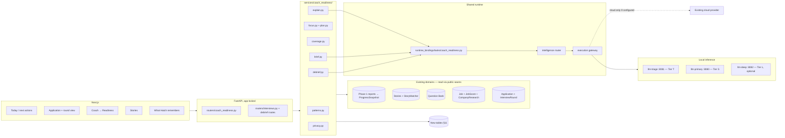
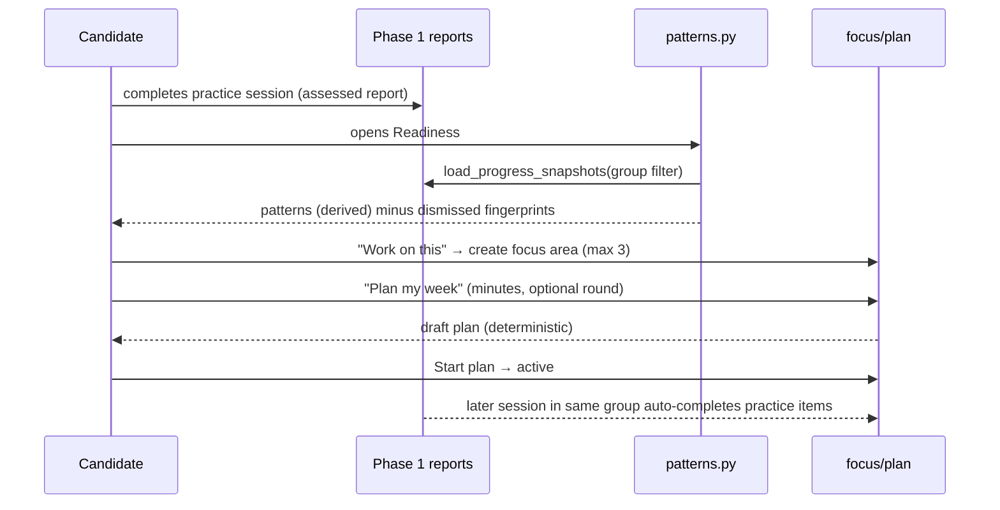
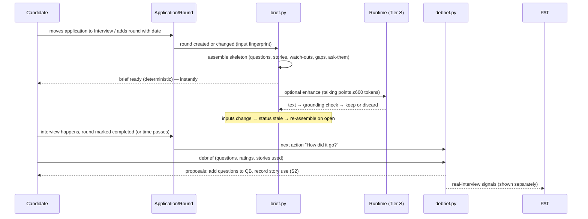
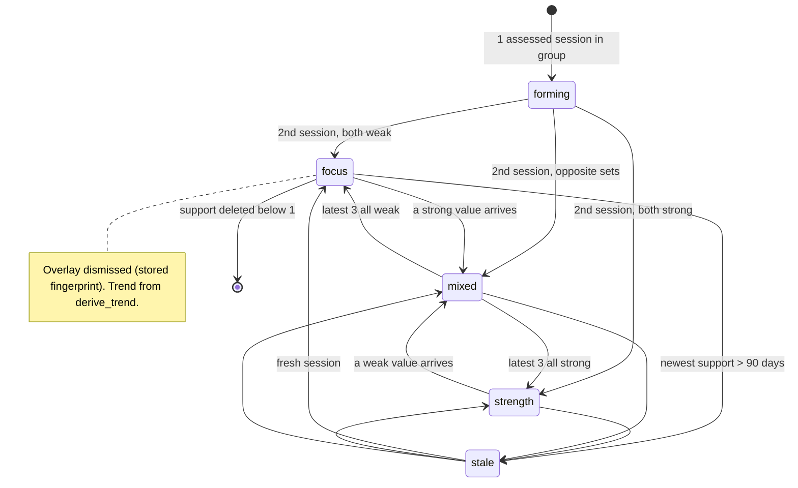
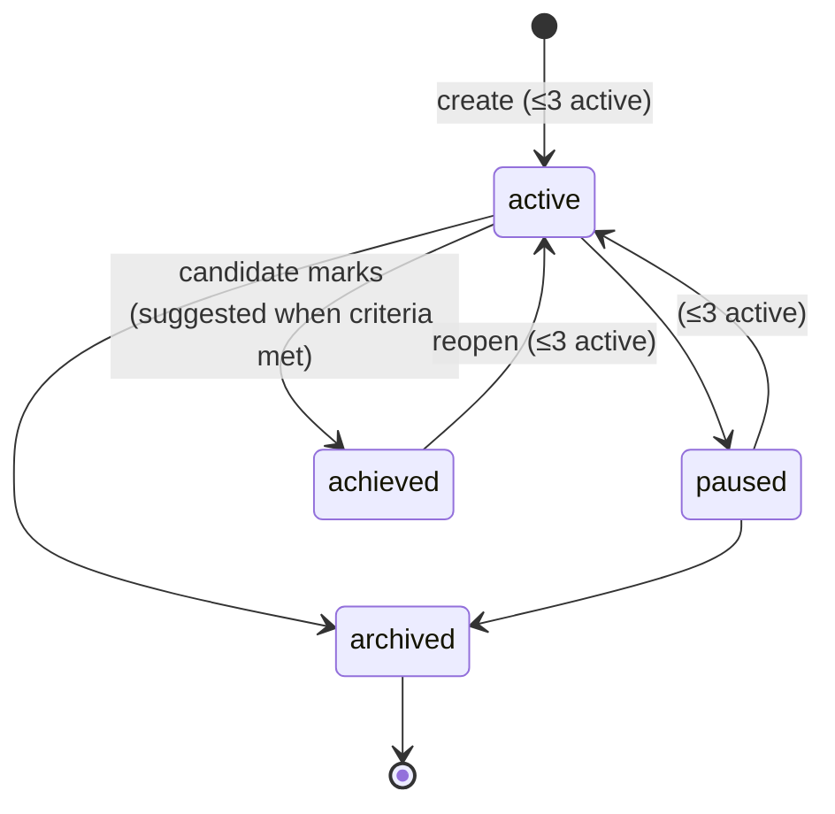
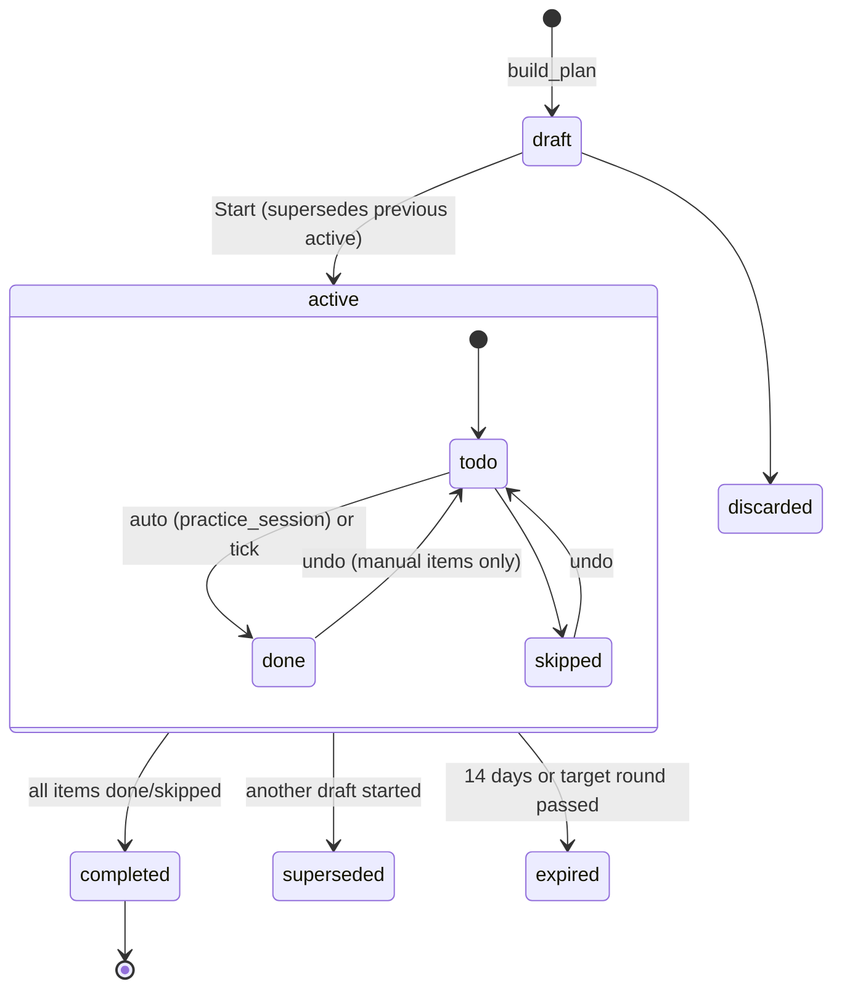
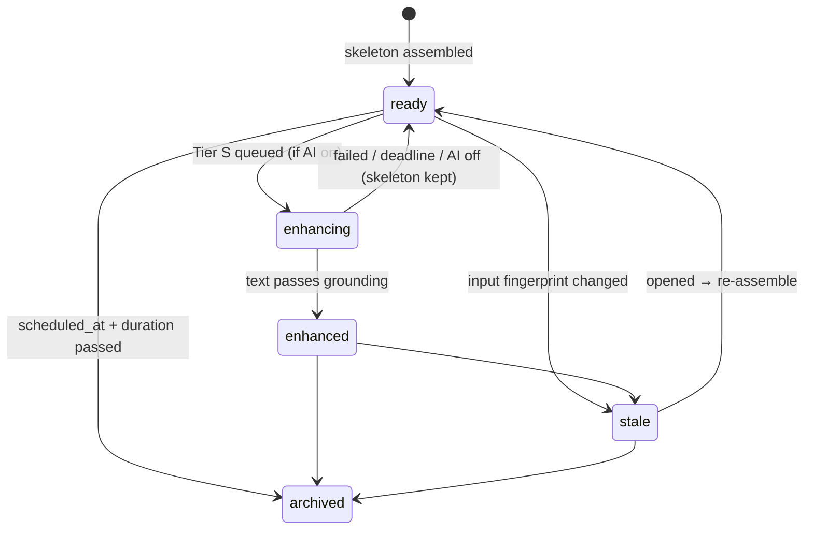
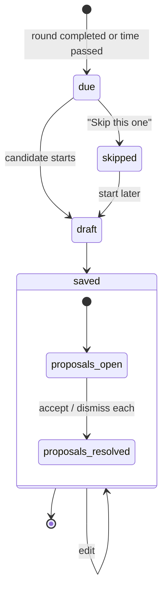
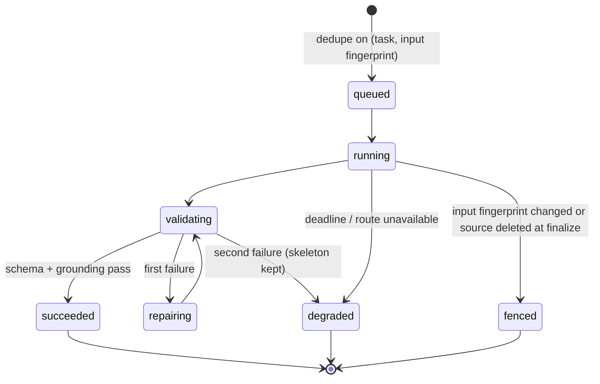
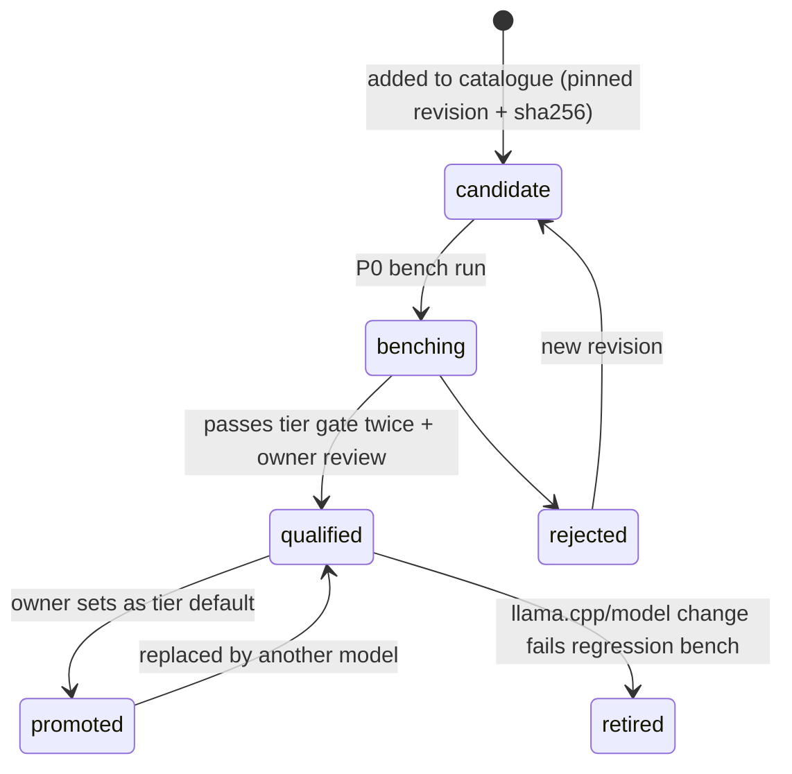

# Hatch Coach Phase 2 — Interview Readiness Loop

**Date:** 22 October 2026
**Status:** Final for implementation (owner decision, 2 Nov 2026). Changes go into this file, not addenda.
**Delivery:** OpenCode (Go subscription) writes code. Claude Code reviews every PR and writes the failing contract tests first for high-assurance tasks.
**Normative document:** this file. The plan sequences it; the HTML page only illustrates it. If they disagree, this file wins and the others are corrected.

## 0. Owner decisions (22 Oct 2026)

| ID | Decision | Consequence |
|---|---|---|
| D1 | Phase 2 is a narrow "readiness loop", not the 13-PR v1 draft | v1's M7 Mentor threads, M9 cost routing, S2–S4 are dropped (§2.3) |
| D2 | New features in scope: pre-interview brief, real-interview debrief, story coverage map | Retry-and-compare is out |
| D3 | Mentor becomes single-turn "Explain" on a pattern | No threads, no message retention, no thread deletion fencing |
| D4 | Local runtime models are chosen by bench-gated tiers | Spark-X2.6-4B, MiniCPM 4.7/5 and others are candidates, not defaults, until they pass §9 |
| D5 | Deliverables: dated Markdown spec + plan, plus an HTML companion | One normative document (this one) |
| D6 | Wave 0 starts now; foundation R7–R9 are paused with no committed date | Wave 1 no longer waits for R9; it uses the readiness check in §3.2 |
| D7 | 90-day pattern window and 14-day plan expiry accepted | Config defaults in §7.1.2 and §8.3 |
| D8 | Brief archives at `scheduled_at + duration` (60 min when unset) | §7.5 |
| D9 | Delivery patterns (former S1) deferred | Moved to §2.2; AC26 deferred |
| D10 | Claude Code replaces Codex as reviewer and high-assurance test author (2 Nov 2026) | §16; plan §1 |
| D11 | Screen designs approved as the UI reference (2 Nov 2026) | §13.3a; `docs/visual-evidence/coach-phase2-design/` |

All open questions from the 22 Oct draft are resolved (§17).

## 1. Purpose and outcome

Hatch already practises, evaluates and stores interviews (Phase 1). What it lacks is the loop that turns that evidence into readiness for a **real, scheduled interview**, and learns back from how that interview went.

**Outcome:** before each real interview the candidate has a one-page brief built from their own evidence; after it, a two-minute debrief feeds the next one.

```
practice → patterns → focus → plan → brief → real interview → debrief ─┐
   ▲                                                                   │
   └───────────────────────────────────────────────────────────────────┘
```

### 1.1 Success measures (user #1, measured over the first 30 days after rollout)

| Measure | Target |
|---|---|
| Brief ready before a scheduled interview | ≥ 24 h before, for every round with `scheduled_at` set ≥ 24 h ahead |
| Debrief captured | Within 72 h for ≥ 80 % of completed rounds |
| Time to first useful pattern | Visible after the 2nd assessed session in a group (§7.1) |
| AI-off usefulness | Every M-feature renders useful content with AI mode = None |
| Local latency | Every model-backed action returns or degrades within its tier deadline (§9.3) on the reference machine |

## 2. Scope

### 2.1 MoSCoW

| ID | Priority | Deliverable | AC |
|---|---|---|---|
| M1 | Must | **Patterns**: recurring strengths/focus areas from practice, derived on read | AC01–AC05 |
| M2 | Must | **Focus areas** (goals-lite): max 3 active, template criteria | AC06–AC07 |
| M3 | Must | **Practice plan**: deterministic, time-boxed, interview-aware | AC08–AC09 |
| M4 | Must | **Story coverage map**: job competencies vs Story Bank | AC10–AC11 |
| M5 | Must | **Pre-interview brief** per interview round | AC12–AC15 |
| M6 | Must | **Real-interview debrief** per interview round | AC16–AC18 |
| M7 | Must | **Explain**: single-turn tips on a pattern | AC19 |
| M8 | Must | **Local model tiers** with bench gate, catalogue and routing changes | AC20–AC22 |
| M9 | Must | **"What Hatch remembers"** page and derived-data deletion cascade | AC23–AC25 |
| S2 | Should | Debrief → Question Bank and Story-use proposals | AC27 |
| S3 | Should | Brief print layout (browser print; PDF stays capability-gated) | AC28 |

All Musts form the release. Shoulds ship in the same phase if time allows, otherwise are noted as deferred in release notes.

### 2.2 Won't (this phase)

Delivery patterns for voice sessions (former S1, deferred by D9); persistent Mentor threads; managed routing (OpenRouter), Laya/Clef advisors, spend-reservation ledger; global (cross-role) findings; automatic plan adaptation; retry-and-compare; personas, panels, video, emotion or personality inference; calendar writes; phone app; model training on user data; any new service, container type, vector store or agent framework (an *optional* third llama-server instance in §9.2 reuses the existing image).

### 2.3 What changed from the v1 draft (13 Oct)

| v1 draft | This spec | Why |
|---|---|---|
| Findings persisted as revisions; accept/edit/reject each | Patterns **derived on read** from Phase 1 reports; only dismissals stored | Deletion propagates for free; no review fatigue |
| Grouping by exact `compatibility_key` | Group by role family + interview type + rubric version (§7.1) | The key hashes difficulty and locale too; raising difficulty split evidence, so findings rarely fired |
| `owner_key` on every table | None — single-user, app-locked API, same as Phase 1 | No `owner_key` exists anywhere in the repo at b7274a6 |
| Persistent Mentor (90-day threads) | Single-turn Explain | Commoditised by general assistants; most expensive privacy surface |
| M9 cost routing, spend ledger, routing experiment | Existing router + local tiers; cloud keeps existing budgets | Default runtime is local (USD cost 0) |
| Deadlines 90–180 s, 3–4k output tokens | Tier deadlines from bench; outputs ≤ 600 tokens | Contradicted Phase 1's own 120–300 s CPU deadlines |
| Model output proposes everything; 6 approval gates | HITL only where the action writes elsewhere or changes what you practise | HITL principle is about external/consequential actions |
| 13 PRs, 26 ACs | 10 PRs (2 waves), 28 ACs, smaller each | Phase 1 needed ~10 repair PRs; keep each PR small |

## 3. Grounding and prerequisites

### 3.1 Repository facts at b7274a6 (16 Oct 2026)

| Fact | Where | Use in Phase 2 |
|---|---|---|
| Phase 1 acceptance closed 14 Oct (#77–#79); R6 merged 16 Oct (#80) | git log | R7, R8, R9 open and paused (D6) |
| `ProgressSnapshot` carries `role_family`, `role_level`, `interview_type`, `dimensions`, `strengths`, `priorities`, `completed_at` | `services/coach_conversational_progress.py` | Pattern source (add rubric version + difficulty, §7.1.6) |
| `derive_trend(levels)` over latest 3 assessed | same | Reused for pattern trend |
| Levels `needs_work < developing < interview_ready < strong`, plus `not_assessed` | `services/coach_conversational_contracts.py` | Pattern rule |
| Content dimensions: relevance, structure, specificity, impact, role_depth, clarity, conciseness | same | Pattern dimensions |
| Delivery families: pace, fillers_per_minute, long_pauses, hedging, restarts; severity none/moderate/material/severe | `schemas/coach_conversation.py` | Deferred (D9) |
| Coach interview types: behavioural, role_specific_verbal, mixed; difficulty supportive < realistic < challenging | same | Grouping, improvement guard |
| `compatibility_key` = hash(role family, role level, interview type, difficulty, rubric contract, locale) | `services/coach_session_plan.py:836-843` | Kept for Phase 1 trend charts only |
| `InterviewRound` has `scheduled_at`, `duration_minutes`, `type`, `interviewer_name`, `feedback`, `prep_notes`, `questions_asked`, `status` (scheduled/completed/cancelled/rescheduled) | `models/application.py` | Brief + debrief anchor |
| Application status `applied → interview → offered/rejected/withdrawn` | `services/application_service.py` | Brief trigger |
| Story Bank: STAR+R, `tags`, `skills`, `metrics`, `strength_score`, `embedding`; `StoryMatcher` (Jaccard + cosine); `/stories/{id}/record-use` | `models/story.py`, `services/story_*.py`, `routers/stories.py` | Coverage map, brief |
| Question Bank items with `skills`, `tags`, `role_family`, `linked_applications` | `models/question_bank.py` | Brief, debrief proposals |
| `Job.skills`; `JobScore.keyword_matches/keyword_misses/strengths/score_gaps` | `models/job.py`, `models/job_score.py` | Competency list |
| `CompanyResearch` table | `models/coach_session.py` | Brief "questions to ask" |
| `/applications/next-actions` returns prioritised actions | `routers/applications.py` | Today surface |
| Local catalogue has 2 pinned models; discovery policy allows publishers bartowski/unsloth and families qwen*/llama-3.2/gemma-3, and requires "instruct"/"chat" in the repo name | `config/model_catalog.json`, `config/model_discovery_policy.json` | M8 changes |
| llama.cpp image is `ghcr.io/ggml-org/llama.cpp:server` (rolling) for `llm-primary` :8080 and `llm-triage` :8081 | `docker-compose*.yml` | M8 pins a build |
| Coach stage timeouts 120–300 s; session create job 2,400 s | `config.py` | Tier deadlines |

### 3.2 Entry gates and waves

The foundation plan's R7–R9 are paused (D6). Phase 2 therefore does not wait for the R9 report. It needs only what already exists at b7274a6: the generic runtime (R0–R5), runtime bindings proven by Job Score and CV Tailor (R5, R6), and a green Phase 1 suite.

**Wave 1 readiness check** (recorded at the start of P4, replaces the R9 gate):
1. Phase 1 acceptance, privacy and recovery suites pass on current `main`.
2. `tests/runtime` passes, and the Job Score or CV Tailor binding still executes through the gateway in its integration test.
3. No open branch modifies the files Phase 2 touches in Phase 1 (`conversational_session_repository.py`, `coach_privacy.py`, `coach_conversational_progress.py`).
4. P0–P3 merged; P3 bench report accepted by the owner.

Phase 2 adds model calls only through its own TaskSpecs. Phase 1 Coach execution stays on its current path and is not migrated by this phase.

| Wave | Starts | PRs | Touches R7/R8 files? |
|---|---|---|---|
| **Wave 0** | Now | P0 docs + bench harness, P1 coverage map, P2 debrief capture, P3 model catalogue/tier config | No |
| **Wave 1** | After the Wave 1 readiness check passes | P4 patterns, P5 focus + plan, P6 runtime bindings + cascade, P7 brief, P8 debrief extraction + proposals, P9 privacy page + acceptance | Reads via narrow seams only |

**Consequence for a later R8:** if R8 is resumed after Phase 2, it must carry forward the two Phase 2 seams in Phase 1 code: the snapshot fields (§7.1.6) and the `on_session_deleted` hook in `coach_privacy.py` (§7.8). R8's plan should list them as preserved behaviour.

## 4. Design principles

1. **Deterministic skeleton, model garnish.** Every feature is complete without a model. A model only rewrites or summarises supplied content into short text. AI mode = None must still give a useful brief, patterns, plan and coverage map.
2. **Derive, don't store.** Anything computable from Phase 1 reports, stories, jobs or rounds is computed on read. Only user decisions and user-authored content are stored, plus a cache of model text that cascades on source deletion.
3. **Keep evidence kinds separate.** Practice levels, real-interview self-ratings and story coverage are never averaged or merged into one score. No readiness percentage.
4. **Calibrated human-in-the-loop.** Observations appear without approval and can be dismissed. Explicit confirmation is required only when an action writes into another domain (Question Bank, Stories) or changes what the candidate practises (starting a plan).
5. **CPU-first budgets.** Short outputs (≤ 600 tokens), short prompts, thinking off or low, deadlines measured on the reference machine (§9).
6. **No new infrastructure.** Reuse FastAPI, SQLite/Alembic, the shared runtime, existing llama.cpp images, existing app lock. No `owner_key`; Phase 1 has none.
7. **Language users understand.** UI never shows "finding", "compatibility key", "evidence state" (glossary in §13.4).

## 5. Architecture



### 5.1 Ownership

| Layer | Owns | Must not |
|---|---|---|
| `services/coach_readiness/*` | Pattern rules, focus/plan logic, coverage scoring, brief assembly, debrief logic, validation of model text | Write Phase 1, Story, QB or Application tables directly |
| Existing domains | Their tables and public services | Import `coach_readiness` |
| `runtime_bindings/tasks/coach_readiness.py` | TaskSpecs, prompts, output schemas | Hold domain policy |
| Generic runtime | Routing, execution, deadlines, retries, lineage | Know any Coach concept |

### 5.2 File boundaries (proposed paths)

| Path | Responsibility |
|---|---|
| `backend/app/services/coach_readiness/contracts.py` | DTOs, enums, limits, error codes |
| `.../patterns.py` | Pattern derivation (pure) + dismissal overlay |
| `.../focus.py` | Focus areas and criteria evaluation |
| `.../plan.py` | Practice plan builder (pure) and item completion |
| `.../coverage.py` | Competency list + story coverage (pure, uses `StoryMatcher`) |
| `.../brief.py` | Brief assembly (pure skeleton) + enhancement orchestration |
| `.../debrief.py` | Debrief commands, signals, proposals |
| `.../explain.py` | Explain request, cache, validation |
| `.../grounding.py` | Deterministic checks on model text (ids, numbers, length) |
| `.../privacy.py` | Inventory, deletion cascade, `on_session_deleted` hook |
| `backend/app/models/coach_readiness.py` | New tables only |
| `backend/app/repositories/coach_readiness_repository.py` | Persistence |
| `backend/app/schemas/coach_readiness.py` | HTTP contracts |
| `backend/app/routers/coach_readiness.py` | Routes (§12) |
| `backend/app/runtime_bindings/tasks/coach_readiness.py` | TaskSpecs (§10) |
| `backend/app/config/model_tiers.json` | Tier → route → qualified model map (§9) |
| `frontend/src/app/coach/readiness/` | Readiness pages |
| `frontend/src/components/coach/readiness/` | Components |
| `frontend/src/lib/coachReadinessApi.ts` | Typed client |

## 6. Dataflow

### 6.1 Practice → patterns → focus → plan



### 6.2 Interview round → brief → debrief



## 7. Feature specifications

### 7.1 M1 — Patterns

#### 7.1.1 Group

`group = (role_family, interview_type, evaluation_contract_version)`.
Role level, difficulty and locale are **not** in the group; they are shown on each supporting session. A session without `role_family` falls into `role_family = "unspecified"`.

Trade-off: a coarser group gets evidence sooner but compares answers given at different difficulties. Mitigation in §7.1.4.

#### 7.1.2 Rule (per group × content dimension)

1. Take assessed sessions in the group, newest first, `completed_at` within the freshness window (default **90 days**, config `HATCH_COACH_PATTERN_WINDOW_DAYS`). Keep the latest **3**. Order ties by session id.
2. `not_assessed` values are ignored. Count distinct sessions, never attempts.
3. Classify:
   - **focus** — ≥ 2 values in {needs_work, developing} and none in {interview_ready, strong}
   - **strength** — ≥ 2 values in {interview_ready, strong} and none in {needs_work, developing}
   - **mixed** — ≥ 1 from each set
   - **forming** — exactly 1 assessed value ("1 of 2 sessions")
   - otherwise nothing is shown
4. `trend = derive_trend(levels oldest→newest)` (existing function).
5. **Stale**: newest supporting session older than the window → shown greyed under "Older", never used by plan or brief.

#### 7.1.3 Fingerprint and dismissal

`fingerprint = sha256(group, dimension, kind, sorted supporting session ids)`.
Dismissing stores the fingerprint only (no text). When new evidence changes the supporting set, the fingerprint changes and the pattern reappears labelled "Seen again since you dismissed it". Dismissal can be undone.

#### 7.1.4 Improvement guard

A pattern may be labelled **Improving** only when `trend == "improving"` **and** the newest session's difficulty ≥ the oldest supporting session's difficulty (supportive < realistic < challenging). Otherwise show the trend as "Changed at an easier difficulty". This prevents an easier session being read as progress.

#### 7.1.5 Real-interview signals (from M6, shown separately)

Per competency tag: "Asked in N real interviews" and "You rated yourself ≤ 2/5 on it in N debriefs". A signal appears at N ≥ 2. Signals never alter practice patterns and are labelled "From your real interviews".

#### 7.1.6 Seam change

Add `evaluation_contract_version: str` and `difficulty: str | None` to `ProgressSnapshot` and populate them in the repository loader (`report_contract_version` and `session_plan_json.interview.difficulty`). This is the only Wave 1 edit to `conversational_session_repository.py`; it is additive.

#### 7.1.7 Interfaces

```python
def derive_patterns(
    snapshots: Sequence[ProgressSnapshot],
    dismissed: frozenset[str],
    policy: PatternPolicy,          # window_days=90, max_sessions=3
    now: datetime,
) -> tuple[Pattern, ...]: ...

@dataclass(frozen=True)
class Pattern:
    fingerprint: str
    group: PatternGroup             # role_family, interview_type, contract_version
    dimension: str
    kind: Literal["focus", "strength", "mixed", "forming"]
    trend: Trend
    improving_guarded: bool
    supporting: tuple[SupportingSession, ...]   # id, completed_at, level, difficulty, role_level
    stale: bool
    dismissed: bool
```

### 7.2 M2 — Focus areas

- Created from a pattern ("Work on this") or manually. **Max 3 active.**
- Fields: `title` (1–80 chars), `dimension` (one of the seven content dimensions), optional `group`, optional `application_id`, `criteria`, `status`, `version`.
- Criteria templates (no free-form builder):
  - **Level**: "Reach interview_ready or better in {dimension} in 2 practice sessions" — counts assessed sessions in the same group completed after the focus area was created; N fixed at 2.
  - **Practice**: "Finish N plan items" — N 1–10.
- Criterion status (derived): `not_started`, `in_progress`, `met`, `no_evidence_yet`.
- Focus status (stored): see §8.2. Only the candidate marks **Achieved**; the UI suggests it when all criteria are `met`.
- Edits use optimistic concurrency (`expected_version`); a stale edit returns 409 and the UI keeps the draft.

### 7.3 M3 — Practice plan

Inputs: active focus areas, optional target interview round, minutes (default **30**, range 10–120), now.

Item types:

| Type | What it does | Completion |
|---|---|---|
| `practice_session` | Opens Phase 1 session setup prefilled with the group (role family, interview type) and difficulty ≥ last used | **Auto** when a session in that group completes after the plan started |
| `story_work` | Opens a story (or new story) for a gap competency from M4 | Manual tick |
| `review_answer` | Opens a Question Bank item for a likely question | Manual tick |

Rules (pure function `build_plan`):
1. Order focus areas by: linked to target round first, then created_at, then id.
2. For each focus area add one `practice_session` (15 min default). If a target round exists, add up to 2 `story_work` items for its top coverage gaps (10 min) and 1 `review_answer` (5 min).
3. Fit whole items into the minutes, in order; never exceed; report unallocated minutes.
4. Max 6 items. If a target round exists, every item's `due_at` ≤ `scheduled_at` − 2 h.
5. Wording is template text. A Tier S model may rewrite item titles (§10) but cannot change type, minutes, order or targets.

One plan is `active` at a time. A new draft supersedes the active plan only when the candidate starts it.

### 7.4 M4 — Story coverage map

**Competency list for an application (deterministic):**
1. `JobScore.keyword_misses` (gaps first), then `JobScore.keyword_matches`, then `Job.skills`.
2. Normalise (lowercase, trim, collapse whitespace, singularise trailing "s" only for words ≥ 5 chars), de-duplicate, cap at **12**.
3. Optional Tier T extraction (P8) may add up to 4 competencies from the description when the list has < 5; extracted items are labelled "from the job description".

**Coverage:** for each competency call the existing `StoryMatcher` (tags/skills Jaccard + embedding cosine when embeddings exist) over active stories. Score → status:

| Status | Rule (provisional thresholds in `HATCH_COACH_COVERAGE_COVERED_MIN` = 0.55 and `HATCH_COACH_COVERAGE_THIN_MIN` = 0.35; P1 calibrates on fixtures) |
|---|---|
| `covered` | best score ≥ 0.55 and the story has a `result` |
| `thin` | best score ≥ 0.35, or ≥ 0.55 but no `result` / no metric |
| `gap` | otherwise |

Output per competency: status, up to 2 stories (id, title, score, has_metric), and an action: "Use this story" / "Strengthen this story" / "Draft a story". Also an overview across all active applications in `interview` status: competencies that are gaps in ≥ 2 applications.

No model is needed. No new table: computed on read; competency overrides (rename, hide) are stored in `coach_competency_overrides` (§11).

### 7.5 M5 — Pre-interview brief

**Anchor:** one brief per `InterviewRound`. If an application is in `interview` with no round, Today shows "Add your interview date to get a brief"; the brief can still be built without a date.

**Sections (skeleton, all deterministic):**

| # | Section | Source | Limit |
|---|---|---|---|
| 1 | Header | Application, Job, Round (type, local time, duration, location, interviewer) | — |
| 2 | Likely questions | QB items linked to the application → QB items in the role family → questions from the latest Phase 1 session plan for this application | 5 |
| 3 | Your best stories | Coverage map `covered` stories, ranked by match score then `strength_score` | 3, each mapped to competencies |
| 4 | Watch-outs | Active, non-stale `focus` patterns in the matching group + real-interview signals | 2 |
| 5 | Gaps | Coverage `gap` competencies | 2, each with "Draft a story" |
| 6 | Questions to ask them | `CompanyResearch` (if present) else a fixed template set by round type | 3 |
| 7 | Logistics | Round fields | — |

**Enhancement (optional, Tier S):** one talking point (≤ 30 words) per story in section 3 and one sentence per watch-out. Total ≤ 600 output tokens. Validation (`grounding.py`): every talking point references a supplied story id; every number in the text appears in that story; no new names of companies, products or people; length limits. Failure → keep the skeleton, show "Tips unavailable", no retry beyond the runtime's one repair.

**Input fingerprint:** hash of job description hash, story ids+versions, QB ids+updated_at, pattern fingerprints, coverage statuses, CompanyResearch id, round fields. When the fingerprint changes the brief becomes `stale`; opening it re-assembles the skeleton instantly and re-queues enhancement.

**Triggers:** round created or updated with a future `scheduled_at`; application moved to `interview`; candidate presses "Build brief". After `scheduled_at + duration` the brief becomes `archived` (read-only) and the debrief prompt appears.

**Today:** `/applications/next-actions` gains Coach actions: "Interview in 3 days — brief ready", "Brief out of date", "How did it go?".

### 7.6 M6 — Real-interview debrief

**Prompt:** when a round is marked completed, or when `scheduled_at + duration` has passed and status is still `scheduled`.

**Form (target: 2 minutes):**
- Overall feeling 1–5; "Do you expect to progress?" yes / unsure / no.
- Questions asked: the brief's likely questions appear as a checklist ("Were you asked this?") plus quick-add free text. Max 20.
- Per question (optional): self-rating 1–5, story used (picker over Story Bank), one-line note.
- "Went well" and "Do differently" free text (≤ 1,000 chars each).
- Optional "Paste rough notes" → Tier T extraction proposes a question list the candidate confirms (P8).

**Writes:**
- `coach_interview_debriefs` row (user-authored; §11).
- Mirror the confirmed question texts into `InterviewRound.questions_asked` and set round status `completed` if it was `scheduled` — through the existing interview repository, not direct SQL.
- **S2 proposals** (one batch card): "Add 3 new questions to your Question Bank" (dedupe by normalised text against QB) and "Record that you used story X". Accept writes through `QuestionBankService` and `/stories/{id}/record-use`; dismiss stores nothing.

Debriefs are user-authored and are **not** deleted when a practice session is deleted. They are deleted with their round or application (FK cascade) or from the privacy page.

### 7.7 M7 — Explain

On a pattern card:
- **Why?** (deterministic, instant): the counts, dates, difficulty of each supporting session, and up to 2 report excerpts already stored in the Phase 1 report (`strengths` / `priorities` items for that dimension).
- **Tips** (Tier S): up to 3 bullets, ≤ 120 words total, grounded on the dimension's rubric description and the supplied excerpts. No claims about the candidate beyond the excerpts. Cached by `(pattern fingerprint, prompt version, model identity)`; cache rows cascade when a supporting session is deleted.

No thread, no follow-up turns, no stored conversation.

### 7.8 M9 — What Hatch remembers

One page listing every kind of Phase 2 data with count, last updated and a delete control:

| Kind | Stored? | Delete effect |
|---|---|---|
| Patterns | No (derived) | Delete the practice sessions in Coach; link provided |
| Dismissed patterns | Fingerprints only | Clears dismissals |
| Focus areas, plans | Yes | Deletes rows |
| Briefs | Skeleton is derived; enhancement text cached | Deletes cached text; brief re-assembles |
| Debriefs | Yes, user-authored | Deletes rows; round keeps `questions_asked` unless "also clear questions on the round" is ticked |
| Explain tips | Cached text | Deletes cache |
| Competency overrides | Yes | Deletes rows |

Plus "Delete all Coach readiness data" (confirm dialog). Phase 1 sessions are untouched by this page.

**Cascade:** Phase 1 hard deletion of a session calls `ReadinessPrivacy.on_session_deleted(session_id)` **inside the same transaction** (hook added to `coach_privacy.py`). It deletes `coach_derived_text` rows whose `coach_derived_sources` include that session. Patterns need nothing — they disappear on the next read.

## 8. Status models

Statuses below are the only legal values; transitions not drawn are rejected with `invalid_state` (409).

### 8.1 Pattern (derived; not stored)



### 8.2 Focus area (stored)



### 8.3 Practice plan and item (stored)



### 8.4 Brief (stored row; skeleton derived)



### 8.5 Debrief (stored)



### 8.6 Model generation (runtime; per request)



### 8.7 Local model qualification (config + bench reports)



## 9. M8 — Local model tiers

### 9.1 Tiers

| Tier | Route | Tasks | Output cap | Thinking | Candidates (bench order) |
|---|---|---|---|---|---|
| **T** tiny | `llm-triage` :8081 | Debrief note extraction, competency extraction from JD | 256 tokens | off | MiniCPM-V-4.7-1B (text-only), MiniCPM5-2B, Qwen3.5-0.8B (incumbent) |
| **S** small | `llm-primary` :8080 | Explain tips, brief talking points, plan item wording | 600 tokens | off, then low if quality fails | Spark-X2.6-4B, Qwen3.5-4B (incumbent), MiniCPM5-2B, phi4-mini |
| **L** large (optional, off by default) | `llm-deep` :8082 | Same as S when the owner opts in for richer wording | 600 tokens | low | MiniCPM-V-4.7-35B-A3B (MoE, ~3B active), gemma4:12b |

Rules:
- Every Tier L task has a Tier S fallback; every Tier S/T task has a deterministic fallback. No feature requires L.
- Thinking level is a TaskSpec parameter, not a prompt instruction. Spark-X2.6 exposes none/low/high and accepts `chat_template_kwargs: {"enable_thinking": false}`; the adapter must map tier settings to each model's mechanism and strip reasoning text from outputs.
- The existing Coach Phase 1 tasks keep their current routes and models until separately re-benched; this spec does not change them.
- Cloud: if the owner has configured a cloud provider, the router may use it for S/L under existing egress authorisation and budgets. No new cost machinery.

### 9.2 Runtime and catalogue changes

1. **Pin llama.cpp.** Replace the rolling `ghcr.io/ggml-org/llama.cpp:server` tag with a pinned build ≥ **b10828** (needed for Spark's `spark2_5` architecture). P3 records the exact tag and digest after the bench passes on it.
2. **Discovery policy** (`model_discovery_policy.json`): add publishers `xhtoken`, `openbmb`; families `spark-x2`, `minicpm`; accept repos in an allowlisted family without the "instruct"/"chat" marker; accept `image-text-to-text` for allowlisted families when used text-only (no mmproj download).
3. **Pinned catalogue** (`model_catalog.json`): one entry per candidate with `repo_id`, `filename`, `source_revision`, `sha256`, `download_size_gb`, `min_ram_gb`, `recommended_ram_gb`, `license`, new field `tiers: ["T"|"S"|"L"]`. Revisions and hashes are recorded at P0 from the actual files; none are pre-filled in this spec.
4. **Tier map** `config/model_tiers.json`: `{tier: {route, model_id, thinking, max_output_tokens, deadline_s}}`. Only `promoted` models may appear. Loaded at startup, validated, exposed read-only in Settings.
5. **Optional `llm-deep`**: a third service in `docker-compose.local-ai.yml` under a `deep` profile, same image, port 8082, started only when the owner enables Tier L in Settings and RAM ≥ the model's `recommended_ram_gb`.
6. **Hardware gate:** Tier L is hidden when the probe's RAM < 24 GB. The installer's existing probe output is the source.

### 9.3 Deadlines

Initial values; P0 replaces them with measured values: `deadline = 1.5 × p95(measured end-to-end)` rounded up to 10 s, capped by the maxima below.

| Tier | Initial deadline | Max deadline |
|---|---|---|
| T | 30 s | 60 s |
| S | 90 s | 180 s |
| L | 180 s | 300 s |

A deadline is absolute across the one allowed repair attempt.

### 9.4 Bench protocol (P0)

- Suite `backend/benchmarks/coach/fixtures/phase2_v1/` built from **synthetic** CVs, stories, JDs and debrief notes (no real candidate data): 15 explain, 15 brief-enhance, 10 debrief-extract, 8 competency-extract = **48 cases**, split 16 tuning / 32 holdout.
- Run through the existing `python -m benchmarks.coach` harness with a new `phase2` profile, against llama-server on the pinned build, loopback only.
- Two hardware profiles: **reference** (owner's laptop: 8 threads, 31 GiB RAM, 4 GiB VRAM; run CPU-only and with GPU offload) and **floor** (CPU-only, 4 threads, 8 GB RAM limit — T and S ≤ 4B Q4 only).
- Metrics per model × tier × thinking setting: schema-valid %, grounding violations (from `grounding.py`), p50/p95 latency, time-to-first-token, tokens/s, peak RSS, and owner's blind 1–5 rating of 10 random holdout outputs.

**Promotion gate (per tier, on holdout, two independent runs):**

| Criterion | T | S | L |
|---|---|---|---|
| Schema-valid | ≥ 98 % | ≥ 95 % | ≥ 95 % |
| Grounding violations | 0 | 0 | 0 |
| p95 latency on reference CPU-only | ≤ 30 s | ≤ 90 s | ≤ 180 s |
| Peak RSS | ≤ 3 GB | ≤ 6 GB | ≤ 20 GB |
| Owner blind rating mean | ≥ 3.5 | ≥ 3.5 | ≥ 3.8 |
| Floor profile | must pass T | must pass S, or incumbent stays S default on floor | n/a |

Ties go to the smaller RSS, then the incumbent. If no candidate passes, the incumbent stays. Results go to `docs/implementation-reports/coach-phase2/P0-local-model-bench.md`.

## 10. Runtime contracts

| TaskSpec (v1) | Tier | Input (references only) | Output schema | Fallback |
|---|---|---|---|---|
| `coach.readiness.explain` | S | pattern fingerprint, dimension, excerpt ids | `{tips: [str ≤ 60 words] ≤ 3}` | "Tips unavailable" |
| `coach.readiness.brief_enhance` | S (L opt-in) | brief id, input fingerprint, story ids, pattern fingerprints | `{talking_points: [{story_id, text ≤ 30 words}] ≤ 3, watchouts: [{fingerprint, text ≤ 30 words}] ≤ 2}` | Skeleton only |
| `coach.readiness.plan_wording` | S | plan id, item ids | `{titles: [{item_id, text ≤ 12 words}]}` | Template titles |
| `coach.readiness.debrief_extract` | T | debrief id, notes text (≤ 4,000 chars) | `{questions: [str ≤ 200 chars] ≤ 20}` | Manual entry |
| `coach.readiness.competency_extract` | T | job id, description hash | `{competencies: [str ≤ 40 chars] ≤ 4}` | Deterministic list only |

Common rules:
- Inputs are references; content is resolved by the binding's context provider at execution time and never persisted in runtime records, events, traces or logs.
- At most **one** generation plus **one** repair per request; provider SDK retries disabled or counted.
- Dedupe: while a request with the same `(task_id, input_fingerprint)` is queued or running, return its operation id.
- **Fencing at finalize:** recompute the input fingerprint and check that every source id still exists, in the same transaction as the write. Mismatch → status `fenced`, nothing written.
- Model text is plain text, rendered escaped. It never authorises a write.
- AI mode None → requests are not created; UI shows the fallback with "Turn on local AI for tips".

## 11. Persistence

Additive Alembic migration(s), one head, SQLite foreign keys on. No change to Phase 1 tables except the read-only seam in §7.1.6.

| Table | Key columns | Notes |
|---|---|---|
| `coach_pattern_dismissals` | `fingerprint` PK, `dismissed_at` | No content |
| `coach_focus_areas` | `id` PK, `version`, `status`, `title`, `dimension`, `group_json` nullable, `application_id` FK nullable (SET NULL), `criteria_json`, timestamps | `CHECK status IN (...)`; partial unique index not possible for "≤ 3 active" → enforced in a serialised command with CAS |
| `coach_practice_plans` | `id` PK, `version`, `status`, `minutes`, `target_round_id` FK nullable (SET NULL), `items_json`, `started_at`, `completed_at`, timestamps | One `active` row enforced by partial unique index `WHERE status='active'` |
| `coach_interview_briefs` | `id` PK, `interview_round_id` FK unique (CASCADE), `status`, `input_fingerprint`, `enhanced_text_id` FK nullable, `assembled_at`, `archived_at` | Skeleton is not stored |
| `coach_interview_debriefs` | `id` PK, `interview_round_id` FK unique (CASCADE), `status`, `overall`, `expectation`, `questions_json`, `went_well`, `do_differently`, `proposals_json`, timestamps | User-authored |
| `coach_derived_text` | `id` PK, `kind` (explain/brief/plan_wording/extract), `cache_key` unique, `text_json`, `model_identity`, `prompt_version`, `created_at` | All model output lives here |
| `coach_derived_sources` | (`derived_text_id` FK CASCADE, `source_kind`, `source_id`) PK | Index on (`source_kind`, `source_id`) for deletion |
| `coach_competency_overrides` | `id` PK, `application_id` FK (CASCADE), `original`, `replacement` nullable, `hidden` | User-authored |

`source_kind` is a closed enum: `coach_session`, `story`, `question_bank_item`, `job`, `interview_round`. Deleting a story or QB item through its existing service must also call `ReadinessPrivacy.on_source_deleted(kind, id)` in the same transaction (hooks added in P6).

Interview round deletion and application deletion cascade to briefs, debriefs and overrides via FKs. P2 must confirm how application deletion currently removes `interview_rounds`; if it does not cascade, the debrief FK uses CASCADE from the round and P2 adds a test proving no orphan remains.

## 12. API

All under the existing authenticated prefix; app lock applies. Errors use registered safe codes: `invalid_input` 422, `not_found` 404, `version_conflict` 409, `invalid_state` 409, `limit_reached` 409, `disabled` 403, `temporarily_unavailable` 503.

| Method and path | Purpose |
|---|---|
| GET `/coach/readiness` | Overview: patterns (grouped), active focus areas, active plan, upcoming rounds with brief status, due debriefs |
| GET `/coach/readiness/patterns?group=&include_stale=` | Patterns |
| POST `/coach/readiness/patterns/{fingerprint}/dismiss` · DELETE same | Dismiss / undo |
| GET `/coach/readiness/patterns/{fingerprint}/why` | Deterministic explanation |
| POST `/coach/readiness/patterns/{fingerprint}/tips` | Explain; returns cached text or 202 + operation id |
| GET/POST `/coach/readiness/focus-areas` · PATCH `/{id}` (expected_version) | Focus areas |
| POST `/coach/readiness/plans` (draft) · POST `/{id}/start` · PATCH `/{id}/items/{item_id}` | Plans |
| GET `/coach/readiness/coverage?application_id=` · GET `/coach/readiness/coverage/overview` | Coverage map |
| PUT `/coach/readiness/coverage/{application_id}/overrides` | Rename/hide competencies |
| GET `/interviews/{round_id}/brief` · POST `/interviews/{round_id}/brief/enhance` | Brief |
| GET/PUT `/interviews/{round_id}/debrief` · POST `/interviews/{round_id}/debrief/extract` · POST `/interviews/{round_id}/debrief/proposals/{id}/accept` | Debrief |
| GET `/coach/readiness/operations/{id}` | Generation status |
| GET `/coach/readiness/memory` · DELETE `/coach/readiness/memory/{kind}` · DELETE `/coach/readiness/memory` | Privacy page |
| GET `/applications/next-actions` (extended) | Adds Coach actions (§7.5) |

Pagination: default 20, max 100, stable order (timestamp, id). Request text limits as stated per feature; unknown fields rejected.

## 13. UI and UX

### 13.1 Information architecture

- **Coach → Readiness** (new tab beside Sessions and Stories): sections in this order — *Next interview* (brief card or "Add a date"), *Focus areas* (≤ 3), *This week's plan*, *Patterns* (by group), *Real-interview signals*.
- **Application detail → Interview round**: Brief and Debrief tabs on each round.
- **Stories**: coverage strip at the top ("3 gaps across your active interviews") with filter.
- **Today**: Coach next-actions (§7.5) with deep links.
- **Settings → AI**: tier table (read-only model names, deadline, status) and the Tier L opt-in.
- **Settings → Privacy → What Hatch remembers** (§7.8).

### 13.2 Interaction rules

1. **Instant first paint.** Every screen renders deterministic content immediately. Model text arrives later in place, with a quiet "Adding tips…" line, never a blocking spinner. If generation ends `degraded`, the line becomes "Tips unavailable — try again" (one tap).
2. **Cold start.** Patterns show progress ("1 of 2 behavioural sessions for Delivery Lead — practise once more to see patterns") rather than an empty state.
3. **Two user-facing evidence states.** "Needs more practice" (forming / no evidence yet) and "Older" (stale). Details on hover/tap.
4. **One-click paths.** Pattern → "Work on this" (creates focus area) → "Plan my week" → "Start". Brief gap → "Draft a story" opens the story editor prefilled with the competency.
5. **Show the evidence.** "Why?" quotes the report excerpt, with the session date and difficulty; voice sessions offer playback when audio still exists.
6. **Debrief in two minutes.** Checklist of likely questions first; everything else optional; save at any point.
7. **Conflicts.** A 409 keeps the user's draft and offers "Reload and re-apply".
8. **Print.** The brief has a print stylesheet: one A4 page, no navigation, dark text on white (S3).

### 13.3 Accessibility

Keyboard operation for all controls (including plan item ticks and checklist), visible focus, labelled dialogs, `aria-live="polite"` for arriving tips, reduced-motion respected, colour never the only signal (pattern kinds use icon + text), existing dark theme.

### 13.3a Design references

- **In the repository (what agents use):** `docs/visual-evidence/coach-phase2-design/README.md` indexes the screens, maps every element to an existing `components/ui` component or token, and lists the states each screen must support. Screenshots are in `screens/` (dark, light, A4 print, phone width); the design source is in `source/` (reference HTML, not code to copy). The Hatch design-system brand book and tokens are in `design-system/`.
- **For the owner:** the same designs live in Claude Design as the private "Coach Readiness" canvas and "Hatch" design system. Agents cannot open those links; the repository copy is the reference.
- Implement against these in P1, P2, P4, P5 and P7. The designs show invented example data only (company, people, stories); never put that text into fixtures that look like real candidate data.
- **Design decisions carried from the canvas into implementation:** pattern cards show the kind as icon + words; "Why?" is inline under the pattern, tips arrive in a polite live region with skeleton lines; plan items show minutes in `font-mono` and auto-ticked items are struck through with the date; focus-area criteria use a 6px bar plus "N of M" text; debrief ratings are 44px pressed-state buttons; debrief text areas use the Input styling, not the legacy Textarea.

### 13.4 Glossary (engineering → UI)

| Engineering term | UI copy |
|---|---|
| pattern kind `focus` | Focus area suggestion |
| `strength` | Strength |
| `mixed` | Mixed results |
| `forming` | Needs more practice |
| `stale` | Older |
| group | "{Role family} · {interview type}" |
| real-interview signal | From your real interviews |
| coverage `covered` / `thin` / `gap` | Ready story / Could be stronger / No story yet |
| brief `stale` | Updated — refresh |
| generation `degraded` | Tips unavailable |

## 14. Flags and rollout

| Flag (default false) | Gates |
|---|---|
| `HATCH_COACH_READINESS_ENABLED` | Patterns, focus, plan, explain, privacy page |
| `HATCH_COACH_BRIEF_ENABLED` | Brief creation and enhancement |
| `HATCH_COACH_DEBRIEF_ENABLED` | Debrief prompts and capture |
| `HATCH_COACH_STORY_COVERAGE_ENABLED` | Coverage map |

Flags gate creation and new processing only. Reads of existing rows, the privacy page and all deletion keep working when flags are off. Tier L is a Settings choice, not a flag.

Release gates: Wave 1 readiness check recorded (§3.2); all Must ACs pass; Phase 1 regression suite green; migration upgrade/downgrade on a disposable copy; P0 bench report accepted; Claude Code compliance then quality/security review with zero open Critical/High; owner approval. Rollback = flags off; no schema downgrade in production.

## 15. Acceptance criteria

| ID | Scenario → required outcome |
|---|---|
| AC01 | One assessed session in a group → pattern `forming` shown as "1 of 2"; many attempts in one session never count twice |
| AC02 | Two sessions, same role family + interview type, different difficulty → one group; `focus` when both weak |
| AC03 | Different rubric contract versions → separate groups, never merged |
| AC04 | Newest support older than 90 days → `stale`, excluded from plan and brief |
| AC05 | Dismiss → hidden; new supporting session → reappears labelled; undo works |
| AC06 | 4th active focus area → `limit_reached`; stale `expected_version` → 409 with draft kept |
| AC07 | Level criterion counts only same-group sessions after creation; plan item completion alone never sets it `met` |
| AC08 | 30-minute plan → ≤ 6 whole items, total ≤ 30, unallocated minutes reported, stable order |
| AC09 | Plan targeting a round → every `due_at` ≤ `scheduled_at` − 2 h; practice item auto-completes on a matching session |
| AC10 | Coverage list = misses → matches → skills, normalised, ≤ 12; overrides apply |
| AC11 | Story without `result` never reaches `covered` |
| AC12 | Round created with future date, AI off → brief `ready` with all 7 sections from deterministic sources |
| AC13 | Enhancement that cites an unknown story id or a number not in the story → discarded, skeleton kept, status `ready` |
| AC14 | Story edited after brief assembled → brief `stale`; opening re-assembles; enhancement re-queued once |
| AC15 | Round time passes → brief `archived`, debrief `due`, Today shows "How did it go?" |
| AC16 | Debrief save mirrors questions into `InterviewRound.questions_asked` via repository and marks round completed |
| AC17 | Deleting the round or application deletes its brief, debrief and overrides; no orphans |
| AC18 | Deleting a practice session leaves debriefs intact |
| AC19 | Tips request twice with same fingerprint → one generation; cached result returned; deleting a supporting session deletes the cached tips |
| AC20 | Tier map lists only `promoted` models; unknown model id in config → startup validation error with a safe message |
| AC21 | Tier S route unavailable → every feature still renders its deterministic content within 1 s of the request |
| AC22 | Tier L hidden when probe RAM < 24 GB; enabling it never removes the Tier S fallback |
| AC23 | Session hard-deleted while an enhancement runs → finalize is `fenced`; no text referencing it survives |
| AC24 | "Delete all Coach readiness data" removes every Phase 2 row and cache; Phase 1 sessions untouched |
| AC25 | Flags off → no new briefs/plans/generations; reads and deletes work |
| AC26 | Deferred with delivery patterns (D9); number kept so later ACs keep their IDs |
| AC27 | (S2) Accepting a QB proposal creates exactly one QB item even if accepted twice; duplicates by normalised text are not proposed |
| AC28 | (S3) Brief prints on one A4 page with all sections |

Content canary: tests insert a unique string into synthetic transcripts and stories and assert it never appears in runtime records, events, traces or logs.

## 16. Delivery model (summary; detail in the plan)

- **Plan:** OpenCode Go at $10/month. Go Plus ($40) only if Gemini 4 Argon's weekly allowance blocks a high-assurance task. Extra Usage (pay-as-you-go overflow) stays off.
- **Implementer (OpenCode):** default `opencode-go/deepseek-v4.1-flash` for every task's first attempt; escalation `opencode-go/gemini-4-argon` after two failed repair cycles or a Critical/High review finding; `opencode-go/kimi-k3.1-pro` only for a short consult on one stuck problem; `opencode-go/glm-5.3-flash` as a different-family fallback for outages or quota. Exact IDs are confirmed with `/models` at P0; the lineup changes monthly (plan §1).
- **Reviewer (Claude Code):** reviews every PR with `/phase2-review`. For high-assurance PRs (P2 migration and cascade, P6 fencing and derived-data cascade, P9 deletion and release) it writes the RED contract tests first with `/phase2-red`; OpenCode may not modify those files, and the review checks this by diff. Opus 5.5 for high-assurance work and the P9 release review, Sonnet 5.5 for standard reviews.
- **Qualification by real tasks:** P1 qualifies the default model for standard work, P2 for high-assurance work.
- **Stops:** two failed repair cycles → escalate model; weakened test, fabricated result, unrelated mass edit or a privacy or ownership violation → stop and hand to Claude Code.
- **Privacy for coding models:** public repo; never paste `.env`, real CVs, transcripts or `data/` content into a prompt. Use only models listed with 0-day retention and no training (plan §1); never Muse Spark Contributor or Iceman Contributor Free, which train on prompts.

## 17. Risks and open questions

| # | Risk / question (K = risk; R-numbers elsewhere are foundation slices) | Mitigation / owner action |
|---|---|---|
| K1 | Coarser grouping compares different difficulties | Improvement guard (§7.1.4); difficulty shown on every supporting session |
| K2 | Spark needs llama.cpp ≥ b10828; a newer build could change Phase 1 model behaviour | Pin build in P3; rerun Phase 1 smoke bench on the new build before switching |
| K3 | MiniCPM-V-4.7-35B-A3B's on-device speed claims rely on a llama.cpp fork (LES) | Bench on mainline llama.cpp only; fork is out of scope |
| K4 | 4 GiB VRAM partial offload helps the reference machine but not the floor profile | Gates use CPU-only numbers; GPU is a bonus |
| K5 | Coverage thresholds are provisional | P1 calibrates on fixtures and records values in config |
| K6 | R7–R9 paused indefinitely; Phase 1 Coach keeps its own durability path while Phase 2 uses the generic runtime | Accepted (D6). Two execution paths remain until R8 resumes; Phase 2 never calls Phase 1 queues |
| K7 | A resumed R8 could drop the Phase 2 seams in Phase 1 code | §3.2 consequence note; P4 and P6 tests fail if the seams disappear |
| K8 | The Go model list and caps change monthly; DeepSeek's zero-retention agreement is renewed monthly (current one valid to 30 Nov 2026) | Check `/models` and the Go privacy table on the 1st of each month; if DeepSeek's agreement lapses, switch the default to `glm-5.3-flash` (plan §1) |
| Q1–Q4 | Resolved 22 Oct 2026 | D6–D9 in §0 |
| Q5 | Resolved 2 Nov 2026: reviewer and design reference | D10–D11 in §0 |

## Appendix A — Pattern derivation examples

| Sessions in group (oldest → newest), dimension `specificity` | Kind | Trend | Shown as |
|---|---|---|---|
| developing | forming | not_enough_evidence | Needs more practice (1 of 2) |
| developing, needs_work | focus | declining | Focus area suggestion |
| needs_work, developing, interview_ready (realistic → realistic → challenging) | mixed | improving | Mixed results · Improving |
| needs_work, developing, interview_ready (challenging → challenging → supportive) | mixed | improving | Mixed results · Changed at an easier difficulty |
| strong, interview_ready | strength | declining | Strength |
| strong (Mar), strong (Apr), now = Aug | strength, stale | — | Older |

## Appendix B — Brief JSON (response shape)

```json
{
  "round_id": "uuid",
  "status": "ready | enhancing | enhanced | stale | archived",
  "input_fingerprint": "sha256:…",
  "header": {"company": "…", "role": "…", "round_type": "behavioural", "starts_at": "2026-11-03T10:00:00Z", "timezone": "Europe/London", "duration_minutes": 60, "interviewer": "…", "location": "…"},
  "likely_questions": [{"id": "qb:…", "text": "…", "source": "question_bank | session_plan"}],
  "stories": [{"story_id": "…", "title": "…", "competencies": ["stakeholder management"], "score": 0.71, "talking_point": null}],
  "watch_outs": [{"fingerprint": "…", "dimension": "specificity", "source": "practice | real_interview", "sentence": null}],
  "gaps": [{"competency": "budget ownership", "action": "draft_story"}],
  "ask_them": ["…"],
  "enhancement": {"state": "none | pending | applied | unavailable", "model_identity": null}
}
```
